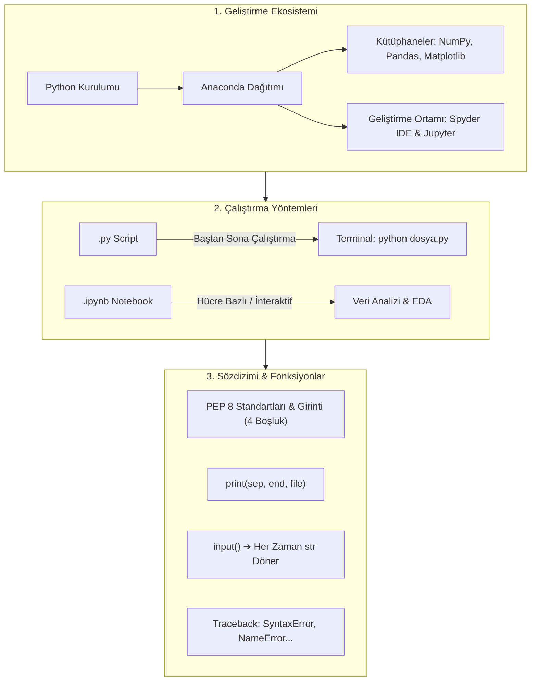

TARGET DECK: data

# 🐍 VBA207 Python Programlama - Hafta 01: Kurulum, Geliştirme Ortamları ve Temel Sözdizimi

---

## 📋 Ders ve Not Bilgileri

| 🏷️ Alan | 📌 Bilgi / Değer |
| :--- | :--- |
| **Ders Kodu & Adı** | VBA207 - Python Programlama |
| **Bölüm & Dönem** | Sakarya Üniversitesi - Veri Bilimi ve Analitiği (2. Sınıf Güz) |
| **Öğretim Üyesi** | Dr. Özkan CANAY |
| **Konu Başlığı** | Hafta 01: Python Kurulumu, Ortamlar (.py vs .ipynb), Sözdizimi, Çıktı & Girdi |
| **Bağlantılı Notlar** | [[H02 Degiskenler ve Temel Veri tipleri]] · [[VBA207_Python_Vize_Master_Calisma_Rehberi]] |
| **Durum / Seviye** | 🟢 Tamamlandı (Vize Hazırlık Düzeyi) |

---

## 🎯 Zihin Haritası ve Konu Akışı



---

## 📦 1. Python Ekosistemi ve Geliştirme Ortamları

![[Pasted image 20261031162445.png]]

### 🔹 Anaconda Dağıtımı Nedir?
* **Tanım:** Python çekirdeği ile birlikte veri analizi, makine öğrenmesi ve bilimsel hesaplama için gereken yüzlerce kütüphaneyi tek bir paket halinde sunan dağıtımdır.
* **Kullanım Alanı:** Veri bilimi (Data Science), Yapay Zeka (AI) ve Makine Öğrenmesi (Machine Learning) alanında çalışanlar için endüstri standardıdır.

### 🔹 Temel Bilimsel Kütüphaneler

| 📚 Kütüphane | 🛠️ Temel Görevi | 💡 Tipik Kullanım Alanı |
| :--- | :--- | :--- |
| **NumPy** | Hızlı çok boyutlu sayısal hesaplamalar ve matris işlemleri | Vektörler, matrisler, lineer cebir |
| **Pandas** | Veri manipülasyonu, tablo/DataFrame yönetimi | Veri temizleme, CSV/Excel okuma |
| **Matplotlib** | 2D/3D statik grafik ve veri görselleştirme | Çizgi, bar, histogram grafikleri |

### 🔹 Spyder IDE
* Anaconda ile birlikte kurulu gelen güçlü bir tümleşik geliştirme ortamıdır (IDE).
* MATLAB kullanıcılarına son derece tanıdık gelen üç panelli arayüzü (Kod Düzenleyici, Değişken Gezgini, İnteraktif Konsol) sayesinde veri analistleri tarafından çokça tercih edilir.

---

## 📄 2. `.py` (Script) vs `.ipynb` (Jupyter Notebook)

| ⚙️ Özellik | 📜 `.py` (Python Script Dosyası) | 📓 `.ipynb` (Jupyter Notebook) |
| :--- | :--- | :--- |
| **Çalışma Biçimi** | Dosya baştan sona tek seferde derlenir/çalıştırılır. | Hücre (cell) bazlı, adım adım ve interaktif çalıştırılır. |
| **Kullanım Alanı** | Üretim (production) ortamları, büyük modüller, otomasyonlar. | Veri keşfi (EDA), görselleştirme, raporlama, deneyler. |
| **Çıktı Saklama** | Sadece kaynak kodu saklar, çıktılar konsola basılır. | Kod hücreleri, çıktılar, grafikler ve metinler aynı dosyada saklanır. |
| **Terminal Komutu** | `python script.py` | `jupyter notebook` / `jupyter lab` |

---

## 💻 3. Terminal ve Komut Satırı Temelleri

```bash
# 1. Python dosyasını terminalden çalıştırma
python dosya.py

# 2. Yüklü Python sürümünü öğrenme
python --version

# 3. İnteraktif Python kabuğunu (REPL) açma
python

# 4. İnteraktif kabuktan çıkış yapma
exit()
```

---

## ✍️ 4. Python Sözdizimi (Syntax), Girintileme ve PEP 8

### 🔹 Büyük / Küçük Harf Duyarlılığı (Case-Sensitivity)
Python kesinlikle **case-sensitive** bir dildir. Aynı ismin farklı harf büyüklüklerindeki halleri tamamen farklı değişkenleri temsil eder:

```python
sayi = 3
Sayi = 5

print(sayi, Sayi)  # Çıktı: 3 5
```

### 🔹 PEP 8 (Python Enhancement Proposal 8)
* Python kodunun nasıl yazılması gerektiğini belirleyen **resmi stil rehberidir**.
* Kodun okunabilirliğini, bakımını ve topluluk standartlarına uygunluğunu sağlar.
* **Temel Kural:** Kod blokları süslü parantez `{}` ile değil, **girintilerle (indentation - 4 boşluk)** belirlenir!

![[Pasted image 20261031163232.png]]

### 🔹 Tırnak İşaretleri ve Kullanımı
* Python'da tek tırnak (`'...'`) ile çift tırnak (`"..."`) arasında işlevsel hiçbir fark yoktur.
* Çok satırlı metinler veya dokümantasyon dizgileri (docstring) için **üçlü tırnak** (`'''...'''` veya `"""..."""`) kullanılır.

```python
metin1 = 'Sakarya'
metin2 = "Üniversitesi"
cok_satirli = """Bu metin
birden fazla satıra
yayılabilir."""
```

![[Pasted image 20261031163320.png]]

---

## 🖨️ 5. Ekrana Çıktı Verme: `print()` Fonksiyonu ve Parametreleri

`print()` fonksiyonu içerisine gönderilen argümanları ekrana basar; ancak varsayılan davranışları parametrelerle değiştirilebilir:

### 🔹 1. `sep` Parametresi (Separator - Ayraç)
* Varsayılan değeri tek bir boşluktur (`" "`).
* Ekrana basılan değerlerin arasına ne koyulacağını belirler.

```python
print("2026", "11", "09", sep="-")
# Çıktı: 2026-11-09
```

### 🔹 2. `end` Parametresi (Satır Sonu Belirteci)
* Python'da `print()` fonksiyonu her çalıştığında otomatik olarak satır sonuna yeni satır karakteri (`\n`) ekler.
* Eğer çıktının aynı satırda devam etmesi isteniyorsa `end` parametresi değiştirilir:

```python
print("Merhaba", end=" ")
print("Python")
# Çıktı: Merhaba Python
```

### 🔹 3. `file` Parametresi (Dosyaya Yazdırma)
* Çıktıyı standart konsol (`sys.stdout`) yerine bir dosyaya yönlendirmek için kullanılır.
* **Kritik Kural:** Açılan dosya `close()` ile mutlaka kapatılmalıdır; aksi takdirde veriler tamponda (buffer) kalabilir.

```python
f = open("deneme.txt", "w", encoding="utf-8")
print("Merhaba dosya!", file=f)
f.close()  # Dosya düzgünce kapatılmalıdır!
```

---

## 📥 6. Kullanıcıdan Veri Alma: `input()` Fonksiyonu

* `input()` fonksiyonu kullanıcıdan klavye yoluyla veri almak için kullanılır.
* > [!WARNING] 🚨 SINAV TUZAĞI: `input()` HER ZAMAN STRING DÖNDÜRÜR!
  > Kullanıcı sayısal bir değer girse bile `input()` fonksiyonunun dönüş tipi **her zaman `str`** türündedir. Matematiksel işlem yapabilmek için tür dönüşümü (`type casting`) zorunludur!

```python
# String girdi alma
isim = input("İsminizi giriniz: ")
print("Hoş geldin,", isim)

# Sayısal girdi alma (Dönüşüm zorunludur!)
yas = int(input("Yaşınızı giriniz: "))
print("Gelecek yıl yaşınız:", yas + 1)
```

---

## 🔤 7. Kaçış Dizileri (Escape Sequences)

Özel anlama sahip veya doğrudan yazılamayan karakterleri string içinde ifade etmek için ters bölü (`\`) kullanılır:

| Kaçış Dizisi | Açıklama | Örnek Çıktı Etkisi |
| :---: | :--- | :--- |
| `\n` | Newline (Yeni satıra geçer) | Alt satıra atlar |
| `\t` | Tab (Sekme boşluğu ekler) | 4 veya 8 karakterlik boşluk bırakır |
| `\"` | Çift tırnak karakteri | String bozulmadan çift tırnak yazar |
| `\'` | Tek tırnak karakteri | String bozulmadan tek tırnak yazar |
| `\\` | Ters bölü (backslash) | Ekrana tek bir `\` basar |

```python
print("Sakarya\nÜniversitesi")
print("Ders:\tVBA207")
print("Python \"kolay\" bir dildir.")
```

---

## 💬 8. Yorum Satırları (Comments)

![[Pasted image 20261031163833.png]]

* **Tek Satırlı Yorumlar:** `#` karakteri ile başlar. Python derleyicisi bu satırları yok sayar.
* **Çok Satırlı Yorumlar:** Fonksiyon/sınıf açıklamalarında (Docstring) üçlü tırnak `""" ... """` kullanılır.

---

## 🚨 9. Python Hata Mesajları (Traceback) ve Temel Hata Türleri

Hata ayıklamada (debugging) Traceback ekranı en kritik bilgi kaynağıdır. Bize sırasıyla:
1. Hatanın gerçekleştiği **dosya adı**,
2. Hatanın oluştuğu **satır numarası**,
3. Hatanın resmi **türü ve açıklaması** sunulur.

![[Pasted image 20261031164024.png]]

### 🔹 Sık Karşılaşılan Temel Hatalar

| ❌ Hata Türü | 🔍 Neden Oluşur? | 💡 Örnek Hatalı Durum |
| :--- | :--- | :--- |
| **`SyntaxError`** | Python yazım/dilbilgisi kurallarına uyulmadığında | Kapanmayan tırnak/parantez (`print("test)`) |
| **`NameError`** | Tanımlanmamış bir değişken çağrıldığında | `print(toplam)` (Henüz `toplam` tanımlanmadı) |
| **`IndentationError`** | Kod bloklarındaki girinti seviyesi hatalı olduğunda | `if` veya döngü altında girinti verilmemesi |
| **`TypeError`** | Uyumsuz tipler arasında işlem yapılmaya çalışıldığında | `print("Yaş: " + 20)` (str ile int toplanmaz) |
| **`ValueError`** | Doğru tipte fakat geçersiz bir değer dönüştürülmeye çalışıldığında | `int("sakarya")` |

---

## 💡 Temiz Kod Yazma İlkeleri

> [!TIP] 🧑‍💻 İyi Bir Programcının Altın Kuralları
> 1. **Anlamlı İsimlendirme:** `a`, `b`, `x1` yerine `ogrenci_notu`, `ortalama` gibi amacını belirten isimler seç.
> 2. **Yorum Satırları:** Kodun ne yaptığını değil, neden yapıldığını açıklayan sade yorumlar bırak.
> 3. **Basit Tut (KISS):** Gereksiz karmaşık iç içe yapılardan kaçın.
> 4. **Hata Yapmaktan Korkma:** Traceback mesajını dikkatlice oku; hatanın satır numarası sana yolu gösterecektir.

---

## 🃏 Anki Kartları

START
Temel
TARGET DECK: data
Ön: Anaconda dağıtımı nedir ve Python geliştiricileri için neden önemlidir?
Geri: Python çekirdeği ile birlikte NumPy, Pandas, Matplotlib gibi yüzlerce bilimsel ve veri analizi kütüphanesini paket halinde sunan kapsamlı bir dağıtımdır. Veri bilimi ve makine öğrenmesi için hazır ortam sağlar.
Tags: from_obsidian, vba207, python, h01
END

---

START
Temel
TARGET DECK: data
Ön: Python veri bilimi ekosisteminde NumPy, Pandas ve Matplotlib kütüphanelerinin temel görevleri nelerdir?
Geri: <ul><li><b>NumPy:</b> Hızlı ve çok boyutlu sayısal/matris hesaplamaları yapar.</li><li><b>Pandas:</b> Tablosal veri manipülasyonu, analiz ve veri temizleme işlemlerini yürütür.</li><li><b>Matplotlib:</b> 2D/3D grafik ve veri görselleştirme kütüphanesidir.</li></ul>
Tags: from_obsidian, vba207, python, h01
END

---

START
Temel
TARGET DECK: data
Ön: Spyder IDE'nin öne çıkan özelliği nedir ve arayüzü hangi programa benzer?
Geri: Anaconda ile gelen, değişken gezgini (Variable Explorer), interaktif konsol ve editörden oluşan üç panelli yapısıyla <b>MATLAB</b> kullanıcılarına tanıdık gelen güçlü bir bilimsel geliştirme ortamıdır.
Tags: from_obsidian, vba207, python, h01
END

---

START
Temel
TARGET DECK: data
Ön: `.py` dosyası ile `.ipynb` (Jupyter Notebook) arasındaki temel fark nedir?
Geri: <ul><li><b>.py:</b> Baştan sona tek seferde çalışan script dosyasıdır; üretim ortamları ve büyük projeler için kullanılır.</li><li><b>.ipynb:</b> Hücre (cell) bazlı, adım adım interaktif çalışan not defteridir; veri analizi, görselleştirme ve denemeler için idealdir.</li></ul>
Tags: from_obsidian, vba207, python, h01
END

---

START
Temel
TARGET DECK: data
Ön: Terminalde bir Python dosyasını çalıştırmak ve yüklü Python sürümünü kontrol etmek için hangi komutlar kullanılır?
Geri: <ul><li>Dosya çalıştırma: <code>python dosya.py</code></li><li>Sürüm kontrolü: <code>python --version</code></li></ul>
Tags: from_obsidian, vba207, python, h01
END

---

START
Temel
TARGET DECK: data
Ön: Python dilinin "Case-Sensitive" (büyük-küçük harfe duyarlı) olması ne anlama gelir? Kod örneğiyle açıklayınız.
Geri: Değişken isimlerinde büyük ve küçük harflerin farklı algılanmasıdır.<br><br><code>sayi = 3</code><br><code>Sayi = 5</code><br>Bu iki değişken bellekte tamamen ayrı alanları temsil eder.
Tags: from_obsidian, vba207, python, h01
END

---

START
Temel
TARGET DECK: data
Ön: PEP 8 nedir ve Python programlamadaki temel amacı nedir?
Geri: <b>Python Enhancement Proposal 8</b>: Python kodunun nasıl yazılması gerektiğini belirleyen resmi stil rehberidir. Kodun okunabilir, tutarlı ve standartlara uygun olmasını sağlar.
Tags: from_obsidian, vba207, python, h01
END

---

START
Temel
TARGET DECK: data
Ön: Python'da kod blokları (fonksiyon, if, döngü) ne ile belirlenir? C veya Java'dan farkı nedir?
Geri: Python'da kod blokları süslü parantez <code>{}</code> ile değil, <b>girintilerle (indentation - standart 4 boşluk)</b> belirlenir.
Tags: from_obsidian, vba207, python, h01
END

---

START
Temel
TARGET DECK: data
Ön: Python'da tek tırnak (<code>' '</code>), çift tırnak (<code>" "</code>) ve üçlü tırnak (<code>""" """</code>) kullanımı arasındaki fark nedir?
Geri: <ul><li>Tek ve çift tırnak arasında işlevsel hiçbir fark yoktur.</li><li>Üçlü tırnak ise birden fazla satıra yayılan metinler ve fonksiyon/sınıf açıklamaları (docstring) için kullanılır.</li></ul>
Tags: from_obsidian, vba207, python, h01
END

---

START
Temel
TARGET DECK: data
Ön: `print()` fonksiyonunda `sep` parametresinin görevi ve varsayılan değeri nedir?
Geri: Ekrana yazdırılan öğelerin arasına yerleştirilecek ayraç karakterini belirler. Varsayılan değeri <b>tek bir boşluktur (" ")</b>.<br><br>Örnek: <code>print("A", "B", sep="-")</code> ➔ <code>A-B</code>
Tags: from_obsidian, vba207, python, h01
END

---

START
Temel
TARGET DECK: data
Ön: `print()` fonksiyonunda `end` parametresinin varsayılan değeri nedir ve nasıl değiştirilir?
Geri: Varsayılan değeri yeni satır karakteridir (<code>\n</code>).<br>Aynı satırda yazdırmaya devam etmek için örneğin <code>end=""</code> veya <code>end=" "</code> şeklinde değiştirilebilir.
Tags: from_obsidian, vba207, python, h01
END

---

START
Temel
TARGET DECK: data
Ön: `print()` fonksiyonu ile doğrudan bir dosyaya çıktı yazdırmak için hangi parametre kullanılır ve sonrasında ne yapılmalıdır?
Geri: <code>file</code> parametresi kullanılır.<br><br><code>f = open("dosya.txt", "w")</code><br><code>print("Metin", file=f)</code><br><code>f.close()</code> ➔ Dosya mutlaka kapatılmalıdır!
Tags: from_obsidian, vba207, python, h01
END

---

START
Temel
TARGET DECK: data
Ön: `input()` fonksiyonunun dönüş tipi nedir? Kullanıcı sayı girdiğinde ne yapılmalıdır?
Geri: <code>input()</code> <b>her zaman string (str)</b> veri tipi döndürür.<br>Sayısal işlemler yapabilmek için <code>int()</code> veya <code>float()</code> fonksiyonlarıyla tip dönüştürme (type casting) yapılmalıdır.
Tags: from_obsidian, vba207, python, h01
END

---

START
Temel
TARGET DECK: data
Ön: Python'da en sık kullanılan kaçış dizileri (escape sequences) <code>\n</code> ve <code>\t</code> ne işe yarar?
Geri: <ul><li><code>\n</code> : Yeni satıra geçiş yapar (Newline).</li><li><code>\t</code> : Bir sekme boşluğu bırakır (Tab).</li></ul>
Tags: from_obsidian, vba207, python, h01
END

---

START
Temel
TARGET DECK: data
Ön: Python'da Traceback hata mesajı hangi 3 temel bilgiyi içerir?
Geri: <ol><li>Hatanın gerçekleştiği <b>dosya bilgisi</b>,</li><li>Hatanın oluştuğu <b>satır numarası</b>,</li><li>Hatanın <b>resmi türü ve açıklaması</b> (SyntaxError, NameError vb.).</li></ol>
Tags: from_obsidian, vba207, python, h01
END

---

START
Temel
TARGET DECK: data
Ön: `SyntaxError` ile `NameError` arasındaki fark nedir?
Geri: <ul><li><b>SyntaxError:</b> Dilin sözdizim kurallarına aykırı yazım olduğunda (kapanmayan tırnak/parantez vb.) derleme/yorumlanma anında çıkar.</li><li><b>NameError:</b> Tanımlanmamış veya yanlış yazılmış bir değişken çağrıldığında çalışma zamanında çıkar.</li></ul>
Tags: from_obsidian, vba207, python, h01
END

---

START
Temel
TARGET DECK: data
Ön: `IndentationError` ne zaman ortaya çıkar?
Geri: Python'da kod bloklarının girintileme seviyesi (standart 4 boşluk) yanlış veya tutarsız yapıldığında ortaya çıkar.
Tags: from_obsidian, vba207, python, h01
END
