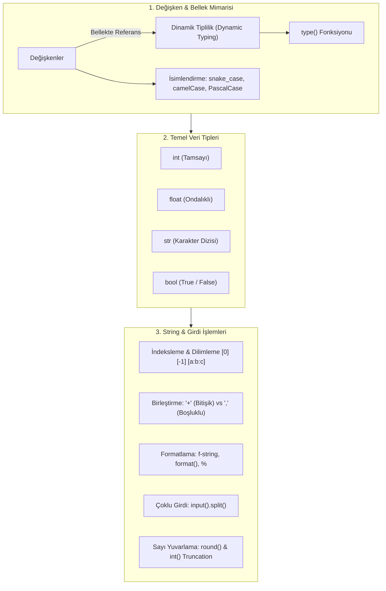

TARGET DECK: data

# 🐍 VBA207 Python Programlama - Hafta 02: Değişkenler, Temel Veri Tipleri ve Tip Dönüşümleri

---

## 📋 Ders ve Not Bilgileri

| 🏷️ Alan | 📌 Bilgi / Değer |
| :--- | :--- |
| **Ders Kodu & Adı** | VBA207 - Python Programlama |
| **Bölüm & Dönem** | Sakarya Üniversitesi - Veri Bilimi ve Analitiği (2. Sınıf Güz) |
| **Öğretim Üyesi** | Dr. Özkan CANAY |
| **Konu Başlığı** | Hafta 02: Değişken Mantığı, Dinamik Tiplilik, Temel Tipler, İndeksleme, `split()` & String Formatlama |
| **Bağlantılı Notlar** | [[python h01]] · [[VBA207_Python_Vize_Master_Calisma_Rehberi]] |
| **Durum / Seviye** | 🟢 Tamamlandı (Vize Hazırlık Düzeyi) |

---

## 🎯 Zihin Haritası ve Konu Akışı



---

## 🧠 1. Değişken Kavramı ve Dinamik Tiplilik (Dynamic Typing)

### 🔹 Değişken Nedir?
* Değişkenler, bilgisayarın ana belleğinde (RAM) verilerin saklandığı alanlara verilen **etiketlerdir / referanslardır**.
* Verileri saklayarak program boyunca **tekrar tekrar kullanmamızı** ve üzerinde matematiksel/mantıksal işlemler yapabilmemizi sağlarlar.

### 🔹 Dinamik Tiplilik (Dynamic Typing)
* Python **dinamik tipli (dynamically typed)** bir programlama dilidir.
* C, C++ veya Java gibi dillerin aksine, bir değişken tanımlanırken türü (`int`, `float`, `str`) önceden açıkça belirtilmez (`int x = 5` yazılmaz, doğrudan `x = 5` yazılır).
* Değişkenin türü, ona atanan değere göre Python yorumlayıcısı tarafından çalışma anında (runtime) dinamik olarak belirlenir.

```python
x = 10         # x şu an bir int (tamsayı)
x = "Sakarya"  # x artık bir str (metin)
```

### 🔹 `type()` Fonksiyonu
Bir değişkenin veya değerin o anda bellekte hangi veri tipinde olduğunu öğrenmek için `type()` fonksiyonu kullanılır:

```python
x = 3.14
print(type(x))  # Çıktı: <class 'float'>

sayi = 42
print(type(sayi))  # Çıktı: <class 'int'>
```

---

## 🏷️ 2. Değişken İsimlendirme Kuralları ve Standartları

### 🔹 Zorunlu Kurallar
1. **Başlangıç Kuralı:** Değişken isimleri mutlaka bir **harf (a-z, A-Z)** veya **alt tire (`_`)** ile başlamalıdır. **Asla bir rakamla başlayamaz!** (Örn: `1sayi` ❌ GEÇERSİZ, `sayi1` veya `_sayi` ✅ GEÇERLİ).
2. **Karakter Seti:** Sadece harfler, rakamlar ve alt tire (`_`) içerebilir. Boşluk veya özel işaretler (`!`, `@`, `#`, `$`, `%`, `-`) içeremez.
3. **Büyük/Küçük Harf Duyarlılığı:** `yas`, `Yas` ve `YAS` tamamen farklı üç değişkendir.
4. **Anahtar Kelime Yasağı:** Python'ın rezerve kelimeleri (`def`, `class`, `if`, `else`, `while`, `for`, `return`, `True`, `False`, `import` vb.) değişken adı olarak kullanılamaz.
5. **İngilizce Karakter Standardı:** Türkçe karakterler (`ç, ş, ğ, ö, ü, ı`) teknik olarak hata vermese de taşınabilirlik ve küresel kod standartları gereği **kesinlikle İngilizce alfabesi** kullanılmalıdır.

### 🔹 İsimlendirme Standartları (Naming Conventions)

| Standart | Biçim / Format | Örnek Kullanım | Python'daki Yeri |
| :--- | :--- | :--- | :--- |
| **snake_case** | Kelimeler küçük harfle yazılır ve alt tire (`_`) ile birleştirilir. | `ogrenci_adi`, `vize_notu` | **Python Standardı (PEP 8)**: Değişken ve fonksiyon isimleri |
| **camelCase** | İlk kelime küçük, sonraki kelimelerin ilk harfi büyük başlar. | `ogrenciAdi`, `vizeNotu` | JavaScript / Java dünyasında yaygındır |
| **PascalCase** | Tüm kelimelerin ilk harfi büyük yazılır. | `OgrenciAdi`, `VizeNotu` | **Python Sınıf (Class)** isimlendirmeleri |

---

## 🔢 3. Temel Veri Tipleri (Data Types)

| Veri Tipi | Açıklama | Örnek Değerler |
| :--- | :--- | :--- |
| **`int`** | Pozitif, negatif veya sıfır tam sayılar | `-25`, `0`, `100` |
| **`float`** | Ondalıklı (kesirli) reel sayılar | `3.14`, `-0.05`, `2.0` |
| **`str`** | Tırnak içinde tutulan karakter dizileri (metinler) | `"Merhaba"`, `'VBA207'`, `"123"` |
| **`bool`** | Doğruluk değerleri (Mantıksal tip) | `True`, `False` |

---

## 🔤 4. Karakter Dizileri (Strings): İndeksleme ve Dilimleme

Python'da string'ler sıralı karakter dizileridir. Her bir karaktere indeks numarası ile erişilebilir.

### 🔹 Pozitif ve Negatif İndeksleme Mantığı
* **Pozitif İndeksler:** Dizinin başından (soldan sağa) başlar ve her zaman **0** ile başlar.
* **Negatif İndeksler:** Dizinin sonundan (sağdan sola) başlar ve her zaman **-1** ile başlar.

```
 Karakter:   |  e  |  l  |  m  |  a  |
 Pozitif:    |  0  |  1  |  2  |  3  |
 Negatif:    | -4  | -3  | -2  | -1  |
```

```python
meyve = "elma"

print(meyve[0])   # Çıktı: 'e' (İlk harf)
print(meyve[-1])  # Çıktı: 'a' (Son harf)
print(meyve[1:3]) # Çıktı: 'lm' (1. indeksten 3. indekse kadar - 3 DAHİL DEĞİL!)
```

### 🔹 String Birleştirme: `+` vs `,` (Virgül) Farkı

![[Pasted image 20261031164933.png]]

* **`+` Operatörü (Concatenation):** String'leri doğrudan birbirine yapıştırır, **araya otomatik boşluk koymaz!** Sadece string ile string toplanabilir.
* **`,` (Virgül / print içi):** Ekrana basarken öğelerin arasına varsayılan olarak **bir adet boşluk (`sep=" "`)** ekler ve farklı türleri dönüştürmeden basabilir.

```python
isim1 = "miray"
isim2 = "emir"

# + kullanımı (Boşluk bırakmaz!)
print(isim1 + isim2 + "birbirini seviyor")
# Çıktı: mirayemirbirbirini seviyor

# Virgül kullanımı (Otomatik boşluk bırakır!)
print(isim1, isim2, "birbirini seviyor")
# Çıktı: miray emir birbirini seviyor
```

---

## 🎨 5. Biçimlendirilmiş Çıktı Yöntemleri (String Formatting)

Python'da değişkenleri metin içerisine dinamik olarak yerleştirmek için 3 ana yöntem vardır:

```python
ad = "Nasuhi"
yas = 21
```

### 🔹 1. f-Strings (Biçimlendirilmiş Dizgiler - Python 3.6+) 🌟 ÖNERİLEN
En modern, en okunaklı ve en hızlı yöntemdir. String'in başına `f` veya `F` konur, süslü parantez `{}` içine değişken veya ifade yazılır:
```python
print(f"{ad}, sen {yas} yaşındasın.")
# Çıktı: Nasuhi, sen 21 yaşındasın.
```

### 🔹 2. `str.format()` Metodu
String içerisindeki `{}` yer tutucularını sırasıyla doldurur:
```python
print("{}, sen {} yaşındasın.".format(ad, yas))
# Çıktı: Nasuhi, sen 21 yaşındasın.
```

### 🔹 3. `%` Biçimlendirici (Eski C Tarzı Biçimlendirme)
Eski Python kodlarında kullanılan yöntemdir. `%s` string, `%d` tamsayı, `%f` float için kullanılır:
```python
print("%s, sen %d yaşındasın." % (ad, yas))
# Çıktı: Nasuhi, sen 21 yaşındasın.
```

---

## 🔄 6. Tip Dönüşümleri (Type Casting) ve Sayısal Kesme

![[Pasted image 20261031205201.png]]

Bir veri tipini başka bir veri tipine dönüştürmek için tür adı fonksiyon olarak kullanılır (`int()`, `float()`, `str()`, `bool()`).

> [!CAUTION] 🚨 SINAV TUZAĞI: `int()` YUVARLAMA YAPMAZ, KESER (TRUNCATE EDER)!
> `int()` fonksiyonu ondalıklı bir sayıyı tamsayıya çevirirken en yakın sayıya yuvarlamaz; **ondalık kısmını tamamen kesip atar (sıfıra doğru kırpar)**!
> * `int(3.14)` ➔ `3`
> * `int(3.99)` ➔ `3` (Asla 4 olmaz!)
> * `int(-3.8)` ➔ `-3`

```python
x = 3.99
print(int(x))  # Çıktı: 3

metin_sayi = "150"
print(int(metin_sayi) + 50)  # Çıktı: 200
```

---

## ⚡ 7. Kullanıcıdan Çoklu Girdi Alma (`split()`)

Kullanıcının birden fazla veriyi tek bir satırda aralarına boşluk koyarak girmesini sağlamak kullanıcı deneyimini artırır. Bu işlem `split()` metodu ile yapılır.

![[Pasted image 20261031205601.png]]

### 🔹 String Değerleri Tek Satırda Alma (Unpacking)
`split()` metodu varsayılan olarak metni **boşluk karakterlerine** göre ayırır ve parçaları değişkenlere dağıtır:

```python
ad, soyad = input("Adınızı ve soyadınızı aralarında boşluk bırakarak giriniz: ").split()
print("Merhaba", ad, soyad)
```

### 🔹 Çoklu Sayısal Girdi Alma ve Matematiksel İşlem
Kullanıcıdan iki sayıyı aynı anda alıp çarpmak için `split()` sonrası tip dönüştürme yapılır:

```python
x, y = input("İki sayı giriniz: ").split()
x, y = int(x), int(y)  # Ayrı ayrı int'e dönüştürülür
print("Çarpım:", x * y)
```

> [!TIP] 💡 Tek Satırda Dönüştürme (`map` ile):
> `x, y = map(int, input("İki sayı giriniz: ").split())` şeklinde daha profesyonel ve kısa olarak da yazılabilir.

---

## 🎯 8. Sayısal Hassasiyet ve Yuvarlama: `round()` Fonksiyonu

Ondalıklı sayıları istediğimiz basamak hassasiyetinde yuvarlamak için `round()` fonksiyonu kullanılır. Özellikle finansal ve istatistiksel hesaplamalarda vazgeçilmezdir.

* `round(sayi)`: Sayıyı en yakın tam sayıya yuvarlar.
* `round(sayi, basamak)`: Virgülden sonra belirtilen basamak kadar yuvarlar.

```python
pi = 3.1415926535

print("Ham değer:       ", pi)
print("2 basamak yuvarla:", round(pi, 2))  # Çıktı: 3.14
print("Tam sayıya yuvarla:", round(pi))     # Çıktı: 3

fiyat = 19.856
print("Finansal format: ", round(fiyat, 2)) # Çıktı: 19.86
```


---

## 🃏 Anki Kartları

START
Temel
TARGET DECK: data
Ön: Python'ın "Dinamik Tipli" (Dynamically Typed) bir dil olması ne anlama gelir?
Geri: Değişken tanımlanırken önceden tür belirtilmesine gerek olmamasıdır. Değişkenin tipi, çalışma anında (runtime) atanan değere göre Python tarafından otomatik olarak belirlenir.
Tags: from_obsidian, vba207, python, h02
END

---

START
Temel
TARGET DECK: data
Ön: Python'da bir değişkenin veya değerin veri tipini öğrenmek için hangi fonksiyon kullanılır? Örnek veriniz.
Geri: <code>type()</code> fonksiyonu kullanılır.<br><br><code>x = 3.14</code><br><code>print(type(x))</code> ➔ <code>&lt;class 'float'&gt;</code>
Tags: from_obsidian, vba207, python, h02
END

---

START
Temel
TARGET DECK: data
Ön: Python'da değişken isimlendirirken uyulması gereken 3 temel kural nedir?
Geri: <ol><li>Mutlaka bir <b>harf</b> veya <b>alt tire (_)</b> ile başlamalıdır; asla rakamla başlayamaz.</li><li>Özel karakterler (<code>!</code>, <code>@</code>, <code>#</code>, <code>$</code>, <code>-</code> vb.) ve boşluk içeremez.</li><li>Python rezerve anahtar kelimeleri (<code>def</code>, <code>class</code>, <code>if</code> vb.) değişken ismi olamaz.</li></ol>
Tags: from_obsidian, vba207, python, h02
END

---

START
Temel
TARGET DECK: data
Ön: Python isimlendirme standartlarından `snake_case`, `camelCase` ve `PascalCase` arasındaki farklar nelerdir?
Geri: <ul><li><b>snake_case:</b> <code>ogrenci_adi</code> (Python'da değişken ve fonksiyon standardı)</li><li><b>camelCase:</b> <code>ogrenciAdi</code> (İlk kelime küçük, sonrakiler büyük harfle başlar)</li><li><b>PascalCase:</b> <code>OgrenciAdi</code> (Tüm kelimeler büyük harfle başlar - Python Class standardı)</li></ul>
Tags: from_obsidian, vba207, python, h02
END

---

START
Temel
TARGET DECK: data
Ön: Python'da karakter dizilerinde (string) pozitif indeksler kaçtan başlar, negatif indeksler kaçtan başlar?
Geri: <ul><li><b>Pozitif indeksler:</b> Soldan sağa doğru <b>0</b>'dan başlar (ilk eleman <code>[0]</code>).</li><li><b>Negatif indeksler:</b> Sağdan sola doğru <b>-1</b>'den başlar (son eleman <code>[-1]</code>).</li></ul>
Tags: from_obsidian, vba207, python, h02
END

---

START
Temel
TARGET DECK: data
Ön: `kelime = "elma"` için `kelime[0]` ve `kelime[-1]` ifadelerinin çıktıları nelerdir?
Geri: <ul><li><code>kelime[0]</code> ➔ <code>'e'</code> (İlk harf)</li><li><code>kelime[-1]</code> ➔ <code>'a'</code> (Son harf)</li></ul>
Tags: from_obsidian, vba207, python, h02
END

---

START
Temel
TARGET DECK: data
Ön: `print()` içerisinde string birleştirmede `+` (artı) ile `,` (virgül) kullanımı arasındaki fark nedir?
Geri: <ul><li><code>+</code> (Concatenation): Değerleri doğrudan birleştirir, <b>araya boşluk koymaz</b>.</li><li><code>,</code> (Virgül): Değerler arasına varsayılan olarak <b>bir boşluk</b> (<code>sep=" "</code>) koyar.</li></ul>
Tags: from_obsidian, vba207, python, h02
END

---

START
Temel
TARGET DECK: data
Ön: Python'da `f-string` yöntemi nasıl kullanılır? Örnek veriniz.
Geri: String tırnaklarının hemen başına <code>f</code> harfi konur ve değişkenler süslü parantez <code>{}</code> içine yazılır.<br><br><code>ad = "Ali"</code><br><code>print(f"Merhaba {ad}")</code> ➔ <code>Merhaba Ali</code>
Tags: from_obsidian, vba207, python, h02
END

---

START
Temel
TARGET DECK: data
Ön: Python'da `format()` metodu ile string biçimlendirme nasıl yapılır?
Geri: Metin içinde <code>{}</code> yer tutucuları bırakılır ve <code>.format()</code> içine sırasıyla değişkenler verilir.<br><br><code>print("{} {} yaşında.".format("Ali", 20))</code>
Tags: from_obsidian, vba207, python, h02
END

---

START
Temel
TARGET DECK: data
Ön: `int(3.99)` ifadesinin çıktısı nedir ve neden 4 değildir?
Geri: Çıktı: <b>3</b><br><br>Çünkü <code>int()</code> fonksiyonu yuvarlama yapmaz; ondalıklı sayının küsuratını doğrudan <b>kesip atar (sıfıra doğru kırpar / truncate eder)</b>.
Tags: from_obsidian, vba207, python, h02
END

---

START
Temel
TARGET DECK: data
Ön: `input().split()` fonksiyonunun temel işlevi nedir?
Geri: Kullanıcıdan tek satırda boşluklarla ayrılmış birden fazla veriyi alıp parçalayarak bir liste olarak döner veya birden çok değişkene dağıtılmasını (unpacking) sağlar.
Tags: from_obsidian, vba207, python, h02
END

---

START
Temel
TARGET DECK: data
Ön: `x, y = input().split()` ile tek satırda iki sayı alındığında neden doğrudan `x * y` yapılamaz? Çözümü nedir?
Geri: Çünkü <code>input()</code> ve <code>split()</code> verileri <b>string</b> olarak alır; iki string birbiriyle çarpılamaz (TypeError).<br><br><b>Çözüm:</b><br><code>x, y = int(x), int(y)</code> yapılmalıdır.
Tags: from_obsidian, vba207, python, h02
END

---

START
Temel
TARGET DECK: data
Ön: `round()` fonksiyonunun işlevi nedir? `round(3.14159, 2)` çıktısı nedir?
Geri: Ondalıklı sayıları istenen basamak hassasiyetinde en yakın değere yuvarlar.<br><br><code>round(3.14159, 2)</code> ➔ <b>3.14</b>
Tags: from_obsidian, vba207, python, h02
END

---

START
Temel
TARGET DECK: data
Ön: Python'da string dilimleme (slicing) genel formülü nedir ve bitiş indeksi dahil midir?
Geri: Formül: <code>dizi[baslangic : bitis : adim]</code><br><br><b>Kritik Kural:</b> Bitiş indeksi (stop index) aralığa <b>DAHİL EDİLMEZ!</b>
Tags: from_obsidian, vba207, python, h02
END

---

START
Temel
TARGET DECK: data
Ön: Python'da `bool()` dönüşümünde hangi temel değerler `False` kabul edilir (Falsy values)?
Geri: <ul><li><code>0</code> (sıfır tamsayı veya float 0.0)</li><li><code>""</code> (boş string)</li><li><code>None</code></li><li><code>[]</code>, <code>()</code>, <code>{}</code> (boş liste, demet veya sözlük)</li></ul>Diğer tüm dolu değerler <code>True</code> döner.
Tags: from_obsidian, vba207, python, h02
END

---

START
Temel
TARGET DECK: data
Ön: Python'da değişken isimlendirirken neden `def = 5` yazılamaz? Hangi hatayı verir?
Geri: <code>def</code> Python'da fonksiyon tanımlamak için kullanılan rezerve bir anahtar kelimedir (keyword). Değişken adı olarak kullanılamaz ve derleyici <b>SyntaxError</b> hatası fırlatır.
Tags: from_obsidian, vba207, python, h02
END
