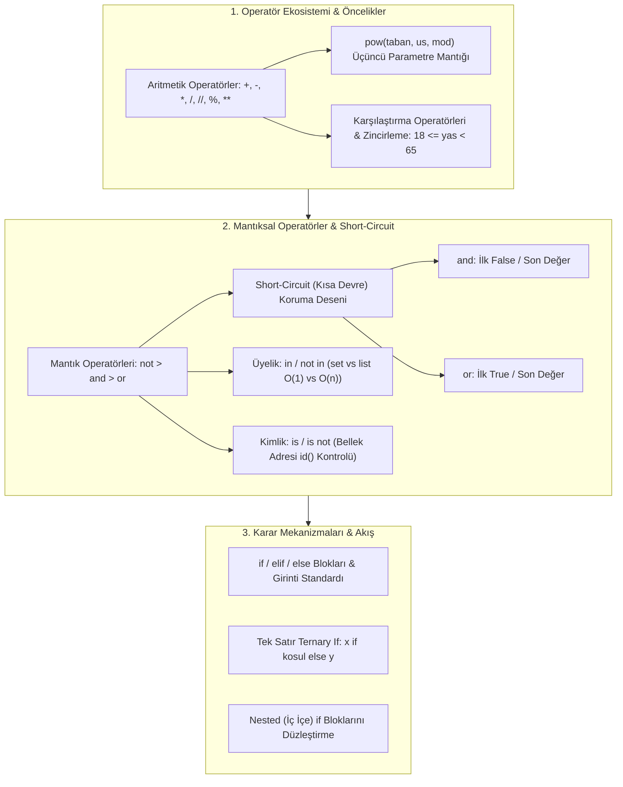

TARGET DECK: data

# 🐍 VBA207 Python Programlama - Hafta 03: Operatörler, Mantıksal İfadeler ve Karar Yapıları

---

## 📋 Ders ve Not Bilgileri

| 🏷️ Alan | 📌 Bilgi / Değer |
| :--- | :--- |
| **Ders Kodu & Adı** | VBA207 - Python Programlama |
| **Bölüm & Dönem** | Sakarya Üniversitesi - Veri Bilimi ve Analitiği (2. Sınıf Güz) |
| **Öğretim Üyesi** | Dr. Özkan CANAY |
| **Konu Başlığı** | Hafta 03: Operatörler, Short-Circuit Değerlendirmesi, Üyelik & Kimlik, Karar Yapıları (if/elif/else), Ternary If |
| **Bağlantılı Notlar** | [[H02_Degiskenler_ve_Temel_Veri_Tipleri]] · [[H04_Donguler_While_For_ve_Karakter_Dizileri]] · [[VBA207_Python_Vize_Master_Calisma_Rehberi]] |
| **Durum / Seviye** | 🟢 Tamamlandı (Vize Hazırlık Düzeyi) |

---

## 🎯 Zihin Haritası ve Konu Akışı



---

## ⚡ 1. Aritmetik ve Atama Operatörleri

Python'da temel matematiksel işlemler ve bellek içi güncellemeler bu operatörlerle yürütülür.

### 📊 Aritmetik Operatörler Tablosu

| Operatör | Anlamı / İşlevi | Örnek | Çıktı / Sonuç | Sınav Notu / Kritik Detay |
| :---: | :--- | :--- | :---: | :--- |
| `+` | Toplama / Birleştirme | `5 + 3` / `'a' + 'b'` | `8` / `'ab'` | Farklı tiplerde (`str + int`) `TypeError` verir! |
| `-` | Çıkarma | `10 - 4` | `6` | Sayısal tiplerde geçerlidir. |
| `*` | Çarpma / Tekrarlama | `3 * 4` / `'py' * 2` | `12` / `'pypy'` | String ile int çarpımı çoğaltma yapar. |
| `/` | Gerçek Bölme (Float) | `10 / 2` | `5.0` | **Sonuç her zaman `float` döner!** |
| `//` | Taban (Tamsayı) Bölme | `10 // 3` | `3` | Aşağı yuvarlar (Floor division). |
| `%` | Mod Alma (Kalan) | `10 % 3` | `1` | Bölümden kalanı tamsayı döner. |
| `**` | Üs Alma (Power) | `2 ** 5` | `32` | Sağdan sola işlem önceliği vardır. |

### 🔍 `pow()` Fonksiyonunun 3. Parametre Sınav Tuzağı

Yerleşik `pow()` fonksiyonu iki veya üç parametre ile çağrılabilir:

```python
# 2 Parametreli Kullanım: Üs alma
print(pow(25, 2))  # 625 (25 ** 2)

# 3 Parametreli Kullanım: Üs al ve modunu hesapla!
# Matematiksel karşılığı: (taban ** us) % mod
print(pow(25, 2, 5))  # 0  -> (625 % 5 = 0)
print(pow(2, 5, 7))   # 4  -> (32 % 7 = 4)
```

> [!IMPORTANT] 🚨 VİZE BANKO SORUSU
> Sınavda `pow(25, 2, 5)` sorulursa hesap makinesi aramaya gerek yoktur. $25$ zaten $5$'in katı olduğu için $25^2$ sayısı $5$'e tam bölünür, kalan doğrudan **`0`** olur.

---

## 🛡️ 2. Mantıksal Operatörler ve Short-Circuit (Kısa Devre) Koruma Mantığı

Python'da mantıksal operatörler boolean (`True`/`False`) döndürmek zorunda değildir. İfadeler soldan sağa değerlendirilir ve sonucu belirleyen **asıl nesne** döndürülür.

### ⚖️ Operatör Öncelik Sırası
1. `not` (En yüksek öncelik)
2. `and` (Orta öncelik)
3. `or` (En düşük öncelik)

```python
# Soru Örneği:
sonuc = not (5 > 3) or (10 == 10 and 3 != 3)
# 1. not (True) -> False
# 2. (True and False) -> False
# 3. False or False -> False
print(sonuc)  # False
```

### 🧠 Short-Circuit (Kısa Devre) Değerlendirmesi

- **`and` Kuralı:** İlk `False` (veya falsy) değere rastlandığında durur ve o değeri döner. Tümü `True` ise **son değeri** döner.
- **`or` Kuralı:** İlk `True` (veya truthy) değere rastlandığında durur ve o değeri döner. Tümü `False` ise **son değeri** döner.

```python
# Falsy Değerler: 0, 0.0, "", [], (), {}, set(), None, False

# 1. and ile Sıfıra Bölme Hatasını (ZeroDivisionError) Engelleme:
sayi = 0
print(sayi and 10 / sayi)  # Çıktı: 0 (Sağ taraf ASLA çalıştırılmaz, çökme olmaz!)

# 2. or ile Varsayılan Değer (Fallback / Default) Atama:
ad = input("Adınız: ") or "Misafir"
# Kullanıcı boş enter basarsa "" (falsy) olduğu için sağdaki "Misafir" atanır!

# 3. Gerçek Değer Döndürme Örnekleri:
a = True and "tamam"   # "tamam"
b = False or "yedek"   # "yedek"
c = "veri" and 42       # 42
d = "" or [] or 100     # 100
```

---

## 🔑 3. Üyelik (`in`) ve Kimlik (`is`) Operatörleri

### 📦 Üyelik Operatörleri (`in`, `not in`)

Bir öğenin koleksiyon (string, liste, demet, küme, sözlük) içerisinde bulunup bulunmadığını denetler.

```python
# String ve Liste İçi Arama:
metin = "Sakarya"
print("kar" in metin)      # True
print("xyz" not in metin)  # True

# SÖZLÜK TUZAĞI (ÇOK ÖNEMLİ):
sozluk = {"ad": "Ali", "puan": 90}
print("ad" in sozluk)      # True  (Anahtar arandı)
print("Ali" in sozluk)     # False (DİKKAT: 'in' varsayılan olarak VALUE değil KEY bakar!)
print("Ali" in sozluk.values()) # True (Değer aramak için .values() gerekir)
```

> [!TIP] ⚡ Set vs List Performansı (O(1) vs O(n))
> Büyük veri analitiğinde üyelik testi yaparken `list` yerine `set` kullanılır:
> - `x in liste` ➔ $O(n)$ Lineer arama (listenin tüm elemanlarını tek tek tarar).
> - `x in kume` ➔ $O(1)$ Sabit zamanlı Hash lookup (anında bulur).

### 🆔 Kimlik Operatörleri (`is`, `is not`) vs Değer Eşitliği (`==`, `!=`)

- `==` : İki nesnenin **değerlerinin** eşit olup olmadığını kontrol eder.
- `is` : İki değişkenin bellekte **aynı adrese (aynı nesneye)** işaret edip etmediğini (`id(a) == id(b)`) denetler.

```python
x = [1, 2, 3]
y = [1, 2, 3]

print(x == y)  # True  (Değerleri aynı)
print(x is y)  # False (Bellekte iki farklı liste nesnesidir!)

# None Kontrolünde PEP 8 Standartı:
deger = None
if deger is None:  # Doğru kullanım (is kullanılır, == değil)
    print("Değer tanımsız.")
```

---

## 🔀 4. Karar Yapıları (`if`, `elif`, `else`) ve Ternary Operatör

### 📝 Standart Karar Blokları ve Zincirleme Karşılaştırma

```python
yas = int(input("Yaşınızı giriniz: "))

# Zincirleme Karşılaştırma (Pythonic Chained Comparison):
if 18 <= yas < 65:
    print("Normal bilet.")
elif yas >= 65:
    print("Emekli indirimi.")
else:
    print("Öğrenci / Çocuk indirimi.")
```

### ⚡ Tek Satır Koşul (Ternary Operator)

Formül: **`[Dogru_Deger] if [Kosul] else [Yanlis_Deger]`**

```python
sayi = 15
durum = "Çift" if sayi % 2 == 0 else "Tek"
print(durum)  # "Tek"

# Doğrudan Fonksiyon İçinde Kullanım:
print("Pozitif" if sayi > 0 else "Negatif veya Sıfır")
```

### 🧹 İç İçe (Nested) `if` Yapılarını Sadeleştirme

```python
# KÖTÜ VE KARIŞIK (Nested):
if notOrt >= 60:
    if devamsizlik <= 20:
        print("Dersi geçtiniz.")

# TEMİZ VE PYTHONIC (Flattened with 'and'):
if notOrt >= 60 and devamsizlik <= 20:
    print("Dersi geçtiniz.")
```

---

## 🧑‍💻 Senior Field Tips & Industry Reality

> [!EXAMPLE] 🧑‍💻 Senior Field Tips & Industry Reality
> - **Acemi Hatası:** `if x == True:` veya `if x == None:` yazmak. Python'da boolean kontrolleri doğrudan `if x:` ve `None` kontrolleri `if x is None:` olarak yazılır.
> - **Sektör Standardı:** Short-circuit değerlendirmesi veri boru hatlarında (Data Pipelines) konfigürasyon doğrulamalarında kullanılır. Örneğin: `api_key = os.getenv("API_KEY") or "default_dev_key"`.
> - **Performans Tuzağı:** Milyonlarca satırlık veride `if item in buyuk_liste:` yazmak kodu saatlerce kilitler. Senior analistler listeyi önce `set(buyuk_liste)` haline getirip $O(1)$ hızında sorgular.

---

## 🃏 Anki Kartları

START
Temel
TARGET DECK: data
Ön: Python'da `pow(25, 2, 5)` fonksiyonunun çıktısı nedir ve arkasındaki matematiksel mantık nasıldır?
Geri: Çıktı: **`0`**<br><br>Mantık: 3 parametreli `pow(taban, us, mod)` ifadesi `(taban ** us) % mod` işlemini yapar. `(25 ** 2) % 5 = 625 % 5 = 0` olur.
Tags: from_obsidian, vba207, python, operatorler
END

START
Temel
TARGET DECK: data
Ön: Python'da Mantıksal Kısa Devre (Short-Circuit) Değerlendirmesi `and` ve `or` için nasıl çalışır?
Geri: <b>and:</b> İlk `False` (veya falsy) değeri bulunca durur ve onu döner; hepsi `True` ise son değeri döner.<br><b>or:</b> İlk `True` (veya truthy) değeri bulunca durur ve onu döner; hepsi `False` ise son değeri döner.
Tags: from_obsidian, vba207, python, mantik
END

START
Temel
TARGET DECK: data
Ön: `sozluk = {"ad": "Ali", "puan": 90}` tanımlandığında `"Ali" in sozluk` ifadesi neden `False` döner?
Geri: Çünkü sözlüklerde `in` operatörü varsayılan olarak **anahtarları (keys)** arar, değerleri (values) aramaz. `"Ali"` bir değer olduğu için `False` döner. Değer aramak için `"Ali" in sozluk.values()` yazılmalıdır.
Tags: from_obsidian, vba207, python, sozlukler
END

START
Temel
TARGET DECK: data
Ön: Python'da `==` operatörü ile `is` operatörü arasındaki temel fark nedir?
Geri: <b>== :</b> Nesnelerin değer eşitliğini denetler.<br><b>is :</b> Nesnelerin bellekteki adreslerinin (kimliklerinin / `id()`) aynı olup olmadığını denetler.
Tags: from_obsidian, vba207, python, kimlik
END

START
Temel
TARGET DECK: data
Ön: Python'da tek satırlık koşullu atama (Ternary Operator) sözdizimi nasıldır?
Geri: <b>`dogru_deger if kosul else yanlis_deger`</b><br><br>Örnek: `durum = "Geçti" if notu >= 60 else "Kaldı"`
Tags: from_obsidian, vba207, python, karar_yapilari
END

---

## 📚 İngilizce Terimler ve B2+ Kelime Dağarcığı

START
Temel
TARGET DECK: ing kelimeler
Ön: Short-circuit evaluation
Geri: Kısa devre değerlendirmesi (Mantıksal ifadelerde sonucun baştan belli olması durumunda geri kalan kısmın çalıştırılmaması)<br>IPA: /ʃɔːrt ˈsɜːrkɪt ɪˌvæljuˈeɪʃn/
Tags: from_obsidian, vocab
END

START
Temel
TARGET DECK: ing kelimeler
Ön: Membership operator
Geri: Üyelik operatörü (Bir öğenin koleksiyonda yer alıp almadığını sorgulayan 'in' ve 'not in' operatörleri)<br>IPA: /ˈmɛmbərʃɪp ˈɒpəreɪtər/
Tags: from_obsidian, vocab
END

START
Temel
TARGET DECK: ing kelimeler
Ön: Precedence
Geri: Öncelik, üstünlük (Matematiksel ve mantıksal operatörlerin işletilme öncelik sırası)<br>IPA: /ˈpresɪdəns/
Tags: from_obsidian, vocab
END

START
Temel
TARGET DECK: ing kelimeler
Ön: Identity operator
Geri: Kimlik operatörü (İki referansın aynı bellek adresini gösterip göstermediğini denetleyen 'is' ve 'is not' operatörleri)<br>IPA: /aɪˈdentɪti ˈɒpəreɪtər/
Tags: from_obsidian, vocab
END
