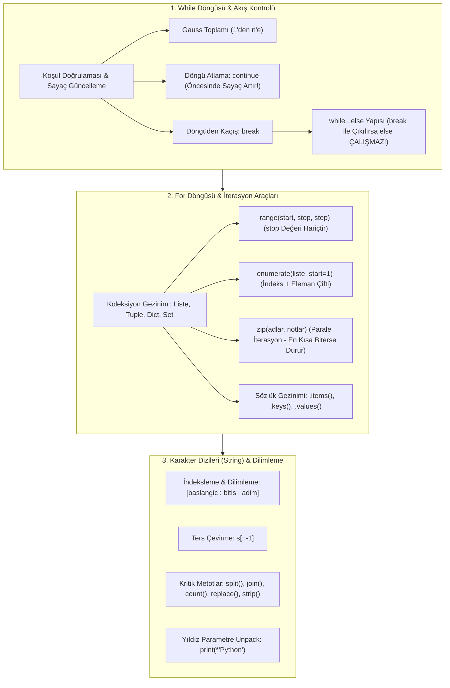

TARGET DECK: data

# 🐍 VBA207 Python Programlama - Hafta 04: Döngüler (While & For), Akış Kontrolü ve Karakter Dizileri (Strings)

---

## 📋 Ders ve Not Bilgileri

| 🏷️ Alan | 📌 Bilgi / Değer |
| :--- | :--- |
| **Ders Kodu & Adı** | VBA207 - Python Programlama |
| **Bölüm & Dönem** | Sakarya Üniversitesi - Veri Bilimi ve Analitiği (2. Sınıf Güz) |
| **Öğretim Üyesi** | Dr. Özkan CANAY |
| **Konu Başlığı** | Hafta 04: `while` & `for` Döngüleri, `while-else` & `for-else`, `break`/`continue`/`pass`, `range()`, `enumerate()`, `zip()`, String Dilimleme & Metotlar |
| **Bağlantılı Notlar** | [[H03_Operatorler_ve_Karar_Yapilari]] · [[H05_Fonksiyonlar_ve_Scope]] · [[VBA207_Python_Vize_Master_Calisma_Rehberi]] |
| **Durum / Seviye** | 🟢 Tamamlandı (Vize Hazırlık Düzeyi - %35 Sınav Ağırlığı!) |

---

## 🎯 Zihin Haritası ve Konu Akışı



---

## 🔄 1. `while` Döngüsü ve Döngü Kontrol İfadeleri

`while` döngüsü, bir koşul `True` olduğu sürece tekrarlanan kontrol yapısıdır. Tekrar sayısının önceden bilinmediği durumlarda tercih edilir.

### ⚠️ Sayaç Güncelleme Zorunluluğu ve Sonsuz Döngü Tehlikesi

```python
# Hatalı (Sonsuz Döngü):
i = 1
while i <= 5:
    print(i)
    # i artırılmazsa koşul sonsuza dek True kalır!

# Doğru Kullanım:
i = 1
while i <= 5:
    print(i, end=" ")
    i += 1  # Çıktı: 1 2 3 4 5
```

### ➕ Gauss Toplamı ($1 + 2 + \dots + n$)

```python
n = int(input("N değerini giriniz: "))
toplam = 0
i = 1

while i <= n:
    toplam += i
    i += 1

print(f"1'den {n}'e kadar olan sayıların toplamı: {toplam}")
```

### 🎛️ `break`, `continue` ve `pass` İfadeleri

- **`break`:** Döngüyü anında sonlandırır ve döngü bloğundan dışarı çıkar.
- **`continue`:** Döngünün o anki turunu atlar, doğrudan bir sonraki iterasyon koşuluna geçer.
- **`pass`:** Boş kod bloklarında sözdizimi hatası almamak için kullanılan yer tutucudur (no-op).

```python
# CONTINUE TUZAĞI: continue öncesi sayaç güncellenmelidir!
i = 0
while i < 10:
    i += 1
    if i % 2 == 0:
        continue  # Çift sayıları atla
    print(i, end=" ")  # Çıktı: 1 3 5 7 9
```

---

## 🚨 2. Sınavın 1 Numaralı Tuzağı: `while...else` ve `for...else`

Python'da döngülerin sonuna `else` bloğu eklenebilir.

> [!IMPORTANT] 🚨 ALTIN KURAL (VİZE TEST BANKOSU)
> `else` bloğu SADECE VE SADECE döngü **`break` ile kırılmadan doğal yolla (koşul False olunca veya tüm elemanlar tükenince)** tamamlanırsa çalışır.
> Eğer döngüden `break` ifadesi ile çıkılmışsa, `else` bloğu **ASLA ÇALIŞMAZ**.

```python
# ÖRNEK 1: break ÇALIŞMADI (else YÜRÜTÜLÜR)
for i in range(3):
    print(i, end=" ")
else:
    print("| bitti")
# Çıktı: 0 1 2 | bitti

# ÖRNEK 2: break ÇALIŞTI (else ATLANIR!)
for i in range(5):
    if i == 2:
        break
    print(i, end=" ")
else:
    print("| bitti")
# Çıktı: 0 1 (else bloğu devreye girmedi!)
```

---

## 🔁 3. `for` Döngüsü ve İterasyon Yardımcı Fonksiyonları

`for` döngüsü, bir koleksiyon (dizi, liste, demet, küme, sözlük veya range) üzerindeki her bir elemanı sırayla ziyaret eder.

### 📏 `range(start, stop, step)` Fonksiyonu
- `range(n)`: `0`'dan başlar, `n`'e kadar gider (`n` hariçtir!).
- `range(bas, son, adim)`: Belirli adım aralıklarıyla dizi üretir.

```python
print(list(range(5)))        # [0, 1, 2, 3, 4]
print(list(range(2, 8, 2)))  # [2, 4, 6]
print(list(range(5, 0, -1))) # [5, 4, 3, 2, 1] (Geriye doğru)
```

### 🔢 `enumerate()` ile İndeks ve Elemana Birlikte Erişme

```python
diller = ["Python", "SQL", "R"]

for sira, dil in enumerate(diller, start=1):
    print(f"{sira}. {dil}")
# 1. Python
# 2. SQL
# 3. R
```

### ⚡ `zip()` ile Paralel Gezinme

Birden çok koleksiyonu eşzamanlı olarak gezer. En kısa koleksiyon bittiğinde döngü otomatik olarak sonlanır.

```python
ogrenciler = ["Ali", "Ayşe", "Mehmet"]
notlar = [85, 92, 78, 100]  # Son not eşleşmez ve atlanır!

for ad, puan in zip(ogrenciler, notlar):
    print(f"{ad} -> {puan}")
```

### 📖 Sözlükler (Dictionary) Üzerinde Gezinme

```python
puanlar = {"Ali": 85, "Ayşe": 95, "Can": 70}

# 1. Sadece Anahtarlar (.keys() veya varsayılan):
for isim in puanlar:
    print(isim)

# 2. Sadece Değerler (.values()):
for notu in puanlar.values():
    print(notu)

# 3. Anahtar-Değer Çiftleri (.items()):
for isim, notu in puanlar.items():
    print(f"{isim}: {notu}")
```

---

## ✂️ 4. Karakter Dizileri (Strings) İleri Dilimleme ve Kritik Metotlar

Karakter dizileri Python'da **değiştirilemez (immutable)** veri tipleridir.

### 📐 Dilimleme (Slicing) Mimarisi: `s[baslangic : bitis : adim]`

```python
s = "Sakarya"

print(s[0])       # 'S'
print(s[-1])      # 'a' (Son karakter)
print(s[1:5])     # 'akar' (1 dahil, 5 hariç!)
print(s[:3])      # 'Sak' (Baştan 3. indekse kadar)
print(s[3:])      # 'arya' (3. indeksten sona kadar)
print(s[::2])     # 'Skay' (İkişer adımla)
print(s[::-1])    # 'ayrakaS' (Metni tersten yazar!)
```

### 🛠️ Sınavda En Çok Çıkan String Metotları

| Metot | Ne Yapar? | Örnek | Sonuç |
| :--- | :--- | :--- | :--- |
| `.split(ayirici)` | Metni belirtilen karaktere göre böler, **liste döner**. | `"veri-bilimi".split("-")` | `['veri', 'bilimi']` |
| `ayirici.join(liste)` | Liste elemanlarını araya karakter koyup birleştirir. | `"-".join(['a', 'b'])` | `'a-b'` |
| `.count(alt_dize)` | Alt metnin kaç kez geçtiğini sayar. | `"Sakarya".count("a")` | `3` |
| `.replace(eski, yeni)` | Karakterleri değiştirir (yeni str döner). | `"veri".replace("v", "V")` | `'Veri'` |
| `.strip()` | Baş ve sondaki boşlukları temizler. | `"  kod  ".strip()` | `'kod'` |
| `.find(x)` vs `.index(x)` | Karakterin indeksini arar. | Bulamazsa `find` **`-1`** döner; `index` **`ValueError`** fırlatır! |
| `.isdigit()` | Sadece rakamlardan mı oluşuyor kontrolü. | `"123".isdigit()` | `True` |

### ⭐ Yıldız Unpack İşlemi
```python
print(*"Python", sep="-")  # P-y-t-h-o-n
```

---

## 🧑‍💻 Senior Field Tips & Industry Reality

> [!EXAMPLE] 🧑‍💻 Senior Field Tips & Industry Reality
> - **Acemi Hatası:** String birleştirmelerinde döngü içinde `metin += yeni_kelime` yapmak. Python'da string immutable olduğu için her seferinde yeni bellek tahsis edilir ($O(n^2)$ yavaşlık). Senior analistler listeye ekleyip en sonda `"".join(liste)` kullanır ($O(n)$ hız).
> - **Endüstri Standardı:** Sonsuz döngü yazarken (`while True`) mutlaka bir **zaman aşımı (timeout)** veya **maksimum deneme limiti (retry-count)** eklenmelidir. Aksi takdirde API veya soket bağlantıları sunucuyu kilitler.
> - **Vize Taktik Notu:** Test sınavında `split()` gördüğün anda dönen sonucun bir `list` olduğunu hatırla. `metin.split("-")[1]` ifadesi listenin 2. elemanını (indeks 1) alır!

---

## 🃏 Anki Kartları

START
Temel
TARGET DECK: data
Ön: Python'da `for...else` veya `while...else` yapısındaki `else` bloğunun çalışma koşulu nedir?
Geri: `else` bloğu, döngü **`break` ifadesi ile kesilmeden doğal yolla** (tüm iterasyonlar bitince veya koşul False olunca) tamamlandığında çalışır. Döngüden `break` ile çıkılırsa `else` bloğu **asla çalışmaz**.
Tags: from_obsidian, vba207, python, donguler
END

START
Temel
TARGET DECK: data
Ön: `s = "Sakarya"` verildiğinde `s[1:5].lower()` kodunun çıktısı nedir ve neden?
Geri: Çıktı: **`'akar'`**<br><br>Açıklama: Python'da indeksleme 0'dan başlar. `1:5` dilimi 1. indeksteki 'a' harfinden başlar ve 5. indeks hariç olduğu için 4. indeksteki 'r' harfinde biter. `.lower()` ise sonucu küçük harfe çevirir.
Tags: from_obsidian, vba207, python, string_slicing
END

START
Temel
TARGET DECK: data
Ön: `metin = "veri-bilimi-analitigi"` verildiğinde `metin.split("-")[1].count("i")` kodunun çıktısı nedir?
Geri: Çıktı: **`3`**<br><br>Açıklama: `.split("-")` metni `['veri', 'bilimi', 'analitigi']` listesine böler. `[1]` ile `'bilimi'` seçilir. `'bilimi'.count("i")` ise 3 adet 'i' harfi sayar.
Tags: from_obsidian, vba207, python, string_metotlari
END

START
Temel
TARGET DECK: data
Ön: Python'da string üzerinde `.find()` metodu ile `.index()` metodu arasındaki fark nedir?
Geri: Aranan karakter metin içinde bulunamazsa:<br>- `.find()` metodu **`-1`** döner.<br>- `.index()` metodu ise programı durduran bir **`ValueError`** istisnası fırlatır.
Tags: from_obsidian, vba207, python, string_metotlari
END

START
Temel
TARGET DECK: data
Ön: Python'da `zip()` fonksiyonunun çalışma mantığı ve farklı uzunluktaki listelerde davranışı nasıldır?
Geri: Birden fazla koleksiyonu paralel olarak eşleştirir ve demetler (`tuple`) üretir. Farklı uzunluktaki listelerde **en kısa liste bittiğinde** döngü otomatik olarak sonlanır (artan elemanlar göz ardı edilir).
Tags: from_obsidian, vba207, python, iterasyon
END

---

## 📚 İngilizce Terimler ve B2+ Kelime Dağarcığı

START
Temel
TARGET DECK: ing kelimeler
Ön: Slicing
Geri: Dilimleme (Dizilerin veya karakter dizilerinin belirli bir aralığını [başlangıç:bitiş:adım] kuralıyla çekip alma işlemi)<br>IPA: /ˈslaɪsɪŋ/
Tags: from_obsidian, vocab
END

START
Temel
TARGET DECK: ing kelimeler
Ön: Immutable
Geri: Değiştirilemez (Oluşturulduktan sonra bellekteki içeriği doğrudan modifiye edilemeyen veri yapıları, örn. str, tuple)<br>IPA: /ɪˈmjuːtəbl/
Tags: from_obsidian, vocab
END

START
Temel
TARGET DECK: ing kelimeler
Ön: Iteration
Geri: İterasyon, yineleme (Bir döngü veya veri yapısı üzerinde adımların tek tek işletilerek tekrarlanması süreci)<br>IPA: /ˌɪtəˈreɪʃn/
Tags: from_obsidian, vocab
END

START
Temel
TARGET DECK: ing kelimeler
Ön: Truncate
Geri: Kırpmak, sonunu kesmek (Sayıların ondalık kısmını yuvarlamadan doğrudan atmak veya dizileri belirli bir noktada kesmek)<br>IPA: /trʌŋˈkeɪt/
Tags: from_obsidian, vocab
END
