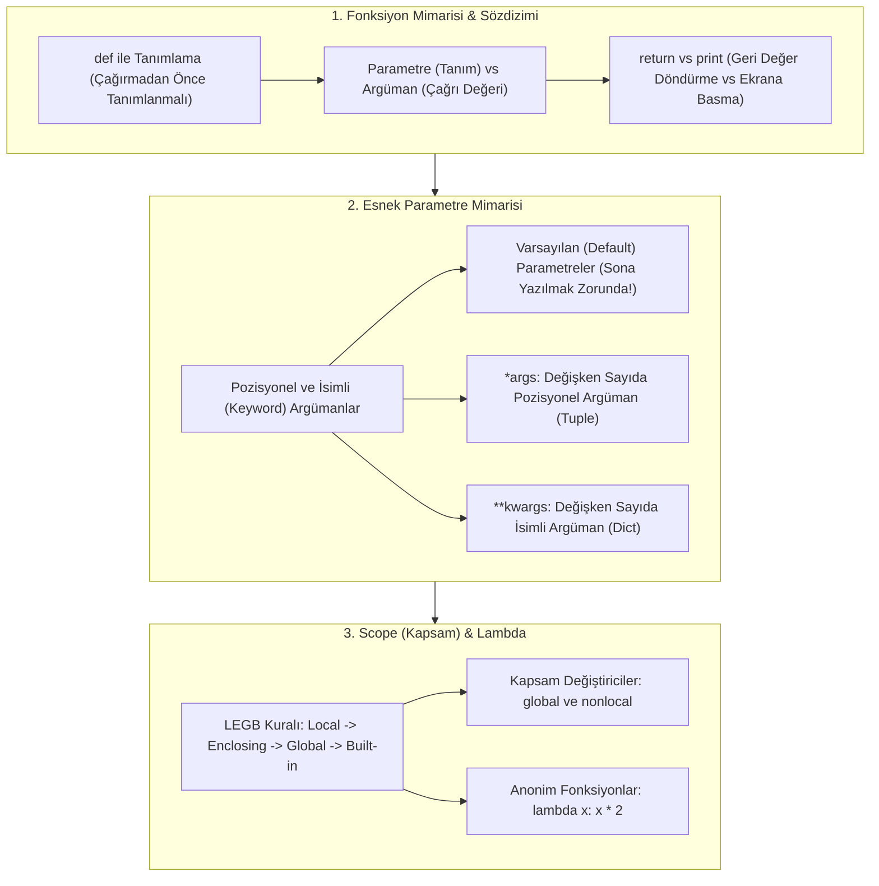
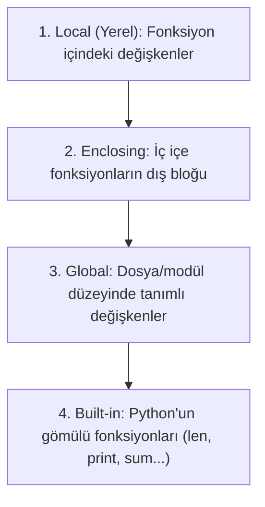

TARGET DECK: data

# 🐍 VBA207 Python Programlama - Hafta 05: Fonksiyonlar, Parametre Mimarisi ve Scope (LEGB)

---

## 📋 Ders ve Not Bilgileri

| 🏷️ Alan | 📌 Bilgi / Değer |
| :--- | :--- |
| **Ders Kodu & Adı** | VBA207 - Python Programlama |
| **Bölüm & Dönem** | Sakarya Üniversitesi - Veri Bilimi ve Analitiği (2. Sınıf Güz) |
| **Öğretim Üyesi** | Dr. Özkan CANAY |
| **Konu Başlığı** | Hafta 05: Fonksiyon Tanımlama (`def`), Argüman Türleri, Varsayılan Değerler, `*args` & `**kwargs`, Scope ve LEGB Kuralı, `lambda` Fonksiyonları |
| **Bağlantılı Notlar** | [[H04_Donguler_While_For_ve_Karakter_Dizileri]] · [[H06_Moduller_Paketler_ve_Kutuphaneler]] · [[VBA207_Python_Vize_Master_Calisma_Rehberi]] |
| **Durum / Seviye** | 🟢 Tamamlandı (Vize Hazırlık Düzeyi - %25 Sınav Ağırlığı!) |

---

## 🎯 Zihin Haritası ve Konu Akışı



---

## 🛠️ 1. Fonksiyon Tanımlama (`def`), Çağırma ve `return` Mantığı

Fonksiyonlar, belirli bir görevi yerine getirmek üzere paketlenmiş, yeniden kullanılabilir (reusable) kod bloklarıdır.

```python
# 1. Tanımlama Sözdizimi:
def topla(a, b):
    """İki sayıyı toplayıp geriye döndüren fonksiyon."""
    sonuc = a + b
    return sonuc

# 2. Çağırma:
deger = topla(10, 20)
print(deger)  # 30
```

> [!WARNING] ⚠️ ÇAĞIRMA SIRASI KURALI
> Python satır satır yorumlanan (interpreted) bir dildir. Bir fonksiyon **tanımlanmadan önce çağrılamaz**. Önce `def` çalışmalı, sonra fonksiyon çağrılmalıdır; aksi halde `NameError` alınır!

### 🔄 `return` ile `print` Arasındaki Hayati Fark

| Özellik | `print()` | `return` |
| :--- | :--- | :--- |
| **İşlevi** | Bilgiyi terminal konsoluna yazdırır. | Değeri çağıran yere geri döndürür. |
| **Değişkene Atama** | `None` döner (değişkene aktarılamaz). | Değer değişkende saklanabilir veya hesaplamada kullanılabilir. |
| **Fonksiyon Akışı** | Fonksiyon çalışmaya devam eder. | Fonksiyonu **anında sonlandırır** (Early Exit). |

```python
def topla_print(a, b):
    print(a + b)

def topla_return(a, b):
    return a + b

x = topla_print(3, 4)   # Ekrana 7 yazar
print(x)                # None döner! (x'in içinde değer yoktur)

y = topla_return(3, 4)
print(y * 2)            # 14 (y değeri matematiksel olarak kullanılabilir)
```

---

## 🎛️ 2. Parametre Tipleri: Default, `*args` ve `**kwargs`

### 1️⃣ Varsayılan (Default) Parametreler
Fonksiyon çağrılırken argüman gönderilmezse önceden belirlenen varsayılan değer devreye girer.

```python
def selamla(ad, mesaj="Hoş geldiniz"):
    print(f"Merhaba {ad}, {mesaj}!")

selamla("Nasuhi")                    # Merhaba Nasuhi, Hoş geldiniz!
selamla("Nasuhi", "İyi çalışmalar")  # Merhaba Nasuhi, İyi çalışmalar!
```

> [!IMPORTANT] 🚨 SÖZDİZİMİ KURALI (TEST SORUSU)
> Varsayılan değere sahip parametreler **her zaman parametre listesinin sonunda** yer almalıdır!
> `def test(a=5, b):` ➔ **`SyntaxError: non-default argument follows default argument`** hatası verir!

### 2️⃣ `*args` — Değişken Sayıda Pozisyonel Argüman
Fonksiyona kaç adet argüman gönderileceği önceden bilinmiyorsa tek yıldız (`*`) kullanılır. Gönderilen tüm değerler fonksiyon içinde bir **`tuple` (demet)** olarak paketlenir.

```python
def topla_hepsi(*sayilar):
    print(f"Gelen tip: {type(sayilar)}") # <class 'tuple'>
    toplam = 0
    for s in sayilar:
        toplam += s
    return toplam

print(topla_hepsi(1, 2, 3))        # 6
print(topla_hepsi(10, 20, 30, 40)) # 100
```

### 3️⃣ `**kwargs` — Değişken Sayıda İsimli (Keyword) Argüman
İki yıldız (`**`), fonksiyona isimli anahtar-değer çiftleri gönderilmesini sağlar. Fonksiyon içinde bir **`dict` (sözlük)** olarak işlenir.

```python
def kullanici_profili(**bilgiler):
    print(f"Gelen tip: {type(bilgiler)}") # <class 'dict'>
    for anahtar, deger in bilgiler.items():
        print(f"{anahtar}: {deger}")

kullanici_profili(ad="Nasuhi", bolum="Veri Bilimi", sinif=2)
```

---

## 🧭 3. Kapsam (Scope) ve LEGB Kuralı

Python'da bir değişken arandığında ad alanları (namespaces) **LEGB** hiyerarşisine göre yukarıdan aşağıya taranır:



### 🌍 `global` ve `nonlocal` Kullanımı

- Fonksiyon içinden bir global değişken **okunabilir**, ancak değeri **değiştirilmek istendiğinde** yerel bir değişken gibi algılanır.
- Global değişkeni fonksiyon içinden güncellemek için `global` anahtar kelimesi bildirilmelidir.

```python
sayac = 10  # Global değişken

def artir():
    global sayac
    sayac += 1  # Globaldeki sayac güncellenir

artir()
print(sayac)  # 11
```

---

## ⚡ 4. Anonim Fonksiyonlar: `lambda` İfadeleri

`lambda`, tek satırlık, isimsiz ve hızlıca tek kullanımlık fonksiyonlar tanımlamak için kullanılır. İfadenin sonucu otomatik olarak `return` edilir.

Sözdizimi: **`lambda parametreler: ifade`**

```python
# Standart Fonksiyon:
def kare_al(x):
    return x ** 2

# Lambda Eşdeğeri:
kare_al_lambda = lambda x: x ** 2

print(kare_al(5))         # 25
print(kare_al_lambda(5))  # 25

# İki Parametreli Lambda:
topla = lambda a, b: a + b
print(topla(3, 7))        # 10
```

---

## 🧑‍💻 Senior Field Tips & Industry Reality

> [!EXAMPLE] 🧑‍💻 Senior Field Tips & Industry Reality
> - **Acemi Hatası:** Fonksiyon parametresinde varsayılan değer olarak **değiştirilebilir (mutable) nesne** (`def ekle(x, liste=[]):`) kullanmak! Liste bellekte paylaşıldığı için her çağrıda eski elemanlar birikir. Senior kural: Her zaman `def ekle(x, liste=None):` yaz ve içeride `if liste is None: liste = []` de!
> - **Global Kullanımından Kaçın:** Senior mimarilerde `global` kullanımı "code smell" (kötü tasarım) kabul edilir. Veriyi fonksiyon parametresi olarak geçip `return` ile geri döndürmek thread-safe ve temiz bir yaklaşımdır.
> - **Lambda Sınırı:** Lambda sadece tek bir ifade içerebilir; içine döngü (`for`), `while` veya çok satırlı `if/elif` yazılamaz.

---

## 🃏 Anki Kartları

START
Temel
TARGET DECK: data
Ön: Python'da fonksiyon tanımında `*args` ve `**kwargs` yapılarının farkı ve tuttukları veri tipleri nelerdir?
Geri: <b>*args:</b> Değişken sayıda pozisyonel argümanı bir <b>`tuple` (demet)</b> olarak toplar.<br><b>**kwargs:</b> Değişken sayıda anahtar=değer biçimindeki isimli argümanı bir <b>`dict` (sözlük)</b> olarak toplar.
Tags: from_obsidian, vba207, python, fonksiyonlar
END

START
Temel
TARGET DECK: data
Ön: Python'da Scope (Değişken Kapsamı) aramasında geçerli olan LEGB kuralının açılımı ve sırası nedir?
Geri: 1. <b>L - Local:</b> Fonksiyon içindeki yerel alan.<br>2. <b>E - Enclosing:</b> İç içe fonksiyonlarda bir üst fonksiyon alanı.<br>3. <b>G - Global:</b> Modül / dosya düzeyindeki alan.<br>4. <b>B - Built-in:</b> Python gömülü isim alanı (len, range, max vb.).
Tags: from_obsidian, vba207, python, scope
END

START
Temel
TARGET DECK: data
Ön: `def topla(a=10, b): return a + b` fonksiyon tanımı neden `SyntaxError` hatası verir?
Geri: Çünkü Python sözdizimi kuralına göre varsayılan (default) değere sahip parametreler **her zaman parametre listesinin sonunda** yer almak zorundadır. Varsayılan parametreden sonra varsayılanı olmayan parametre gelemez (`non-default argument follows default argument`).
Tags: from_obsidian, vba207, python, parametreler
END

START
Temel
TARGET DECK: data
Ön: Python'da bir fonksiyonda `return` ifadesi yazılmazsa veya sadece boş `return` yazılırsa fonksiyon ne döndürür?
Geri: Fonksiyon otomatik olarak <b>`None`</b> nesnesi döndürür.
Tags: from_obsidian, vba207, python, return
END

---

## 📚 İngilizce Terimler ve B2+ Kelime Dağarcığı

START
Temel
TARGET DECK: ing kelimeler
Ön: Scope
Geri: Kapsam, etki alanı (Bir değişkenin veya fonksiyonun program içinde erişilebilir ve geçerli olduğu bölge)<br>IPA: /skoʊp/
Tags: from_obsidian, vocab
END

START
Temel
TARGET DECK: ing kelimeler
Ön: Positional argument
Geri: Konumsal argüman (Fonksiyona gönderilirken değerin sırasına ve konumuna göre parametreye atandığı argüman türü)<br>IPA: /pəˈzɪʃənl ˈɑːrɡjumənt/
Tags: from_obsidian, vocab
END

START
Temel
TARGET DECK: ing kelimeler
Ön: Shadowing
Geri: Gölgeleme, maskeleme (İç kapsamda tanımlanan bir değişkenin, dış kapsamdaki aynı isimli değişkeni geçici olarak görünmez kılması)<br>IPA: /ˈʃædoʊɪŋ/
Tags: from_obsidian, vocab
END

START
Temel
TARGET DECK: ing kelimeler
Ön: Anonymous function
Geri: Anonim fonksiyon (Bir isme bağlanmadan 'lambda' anahtar kelimesiyle tek satırda tanımlanan isimsiz fonksiyon)<br>IPA: /əˈnɒnɪməs ˈfʌŋkʃn/
Tags: from_obsidian, vocab
END
