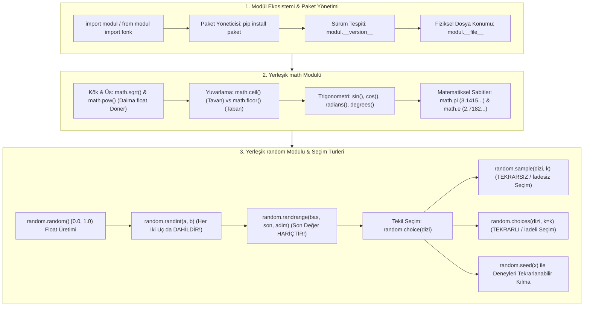

TARGET DECK: data

# 🐍 VBA207 Python Programlama - Hafta 06: Modüller, Paketler ve Yerleşik Kütüphaneler (Math & Random)

---

## 📋 Ders ve Not Bilgileri

| 🏷️ Alan | 📌 Bilgi / Değer |
| :--- | :--- |
| **Ders Kodu & Adı** | VBA207 - Python Programlama |
| **Bölüm & Dönem** | Sakarya Üniversitesi - Veri Bilimi ve Analitiği (2. Sınıf Güz) |
| **Öğretim Üyesi** | Dr. Özkan CANAY |
| **Konu Başlığı** | Hafta 06: Modül ve Paket Mimarisi, pip, `__version__`, `__file__`, `math` Modülü, `random` Modülü (choice vs sample vs choices) |
| **Bağlantılı Notlar** | [[H05_Fonksiyonlar_ve_Scope]] · [[VBA207_Vize_Kod_Izleme_ve_Soru_Bankasi]] · [[VBA207_Python_Vize_Master_Calisma_Rehberi]] |
| **Durum / Seviye** | 🟢 Tamamlandı (Vize Hazırlık Düzeyi) |

---

## 🎯 Zihin Haritası ve Konu Akışı



---

## 📦 1. Modül Ekosistemi ve Paket Yönetimi

Python'da modüller, önceden yazılmış fonksiyonları, sınıfları ve değişkenleri barındıran `.py` uzantılı Python dosyalarıdır.

### 📥 İçe Aktarma (Import) Biçimleri

```python
# 1. Modülü Doğrudan Dahil Etme:
import math
print(math.sqrt(16))  # 4.0

# 2. Takma Ad (Alias) ile Dahil Etme:
import numpy as np

# 3. Belirli Fonksiyonları Dahil Etme:
from math import ceil, floor, pi
print(ceil(4.2))      # 5
```

### 🔍 Kütüphane Sürümü ve Fiziksel Dosya Konumu Tespiti

Bir kütüphanenin sistemde nerede yüklü olduğunu ve hangi sürümünün çalıştığını görmek veri biliminde çakışmaları çözmek için kritiktir:

```python
import numpy

# Kütüphanenin Sürüm Numarasını Öğrenme:
print(numpy.__version__)  # Örn: 1.26.4

# Modül Dosyasının Disk Üzerindeki Fiziksel Konumu:
print(numpy.__file__)     # Örn: /usr/lib/python3.12/site-packages/numpy/__init__.py
```

### 💻 Paket Kurulumu (`pip`)
Terminal üzerinden harici paketler `pip` aracı ile yönetilir:
```bash
pip install kutuphane_adi       # Kurulum
pip install kutuphane==2.1.0    # Belirli bir sürümü kurma
pip list                        # Yüklü tüm paketleri listeleme
pip uninstall kutuphane_adi     # Paketi kaldırma
```

---

## 🧮 2. Yerleşik `math` Modülü ve Hesaplamalar

Python'ın standart kütüphanesinde yer alan `math` modülü C dilinin matematik kütüphanesine dayanır ve yüksek performansla çalışır.

### 📐 Temel Fonksiyonlar ve Sınav İpuçları

```python
import math

# 1. Kök ve Üs İşlemleri:
print(math.sqrt(81))    # 9.0  (DİKKAT: math.sqrt her zaman float döner!)
print(math.pow(2, 5))   # 32.0 (DİKKAT: math.pow her zaman float döner!)

# 2. Yuvarlama İşlemleri:
# ceil (Tavan): Sayıyı kendisinden büyük veya eşit en küçük tamsayıya yukarı yuvarlar.
print(math.ceil(4.1))   # 5
print(math.ceil(-3.7))  # -3 (Negatifte sıfıra yaklaşır!)

# floor (Taban): Sayıyı kendisinden küçük veya eşit en büyük tamsayıya aşağı yuvarlar.
print(math.floor(4.9))  # 4
print(math.floor(-3.2)) # -4 (Negatifte sola doğru uzaklaşır!)

# 3. Trigonometri ve Açı Dönüşümü:
# DİKKAT: math modülündeki trigonometrik fonksiyonlar (sin, cos, tan) RADYAN cinsinden çalışır!
aci_derece = 90
aci_radyan = math.radians(aci_derece)  # Dereceyi radyana çevir
print(math.sin(aci_radyan))            # 1.0

# 4. Matematiksel Sabitler:
print(math.pi)  # 3.141592653589793
print(math.e)   # 2.718281828459045
```

---

## 🎲 3. Yerleşik `random` Modülü: Seçim ve Rastgelelik Mimarisi

Rastgele sayı üretimi, simülasyon ve veri örnekleme (sampling) işlemlerinde kullanılır.

### 🎯 Rastgele Sayı Üretimi: `random()`, `randint()`, `randrange()`

| Fonksiyon | Aralık | Uç Değerler Dahil mi? | Çıktı Türü |
| :--- | :---: | :---: | :---: |
| `random.random()` | $[0.0, 1.0)$ | `0.0` DAHİL, `1.0` **HARİÇ** | `float` |
| `random.randint(a, b)` | $[a, b]$ | **HER İKİ UÇ DA DAHİL!** | `int` |
| `random.randrange(a, b, step)` | $[a, b)$ | `a` DAHİL, `b` **HARİÇ** | `int` |

```python
import random

print(random.random())        # 0.74281... (0.0 ile 1.0 arası float)
print(random.randint(1, 6))   # 1, 2, 3, 4, 5, 6 (Zar atışı: 6 gelebilir!)
print(random.randrange(1, 6)) # 1, 2, 3, 4, 5 (DİKKAT: 6 ASLA gelemez!)
```

### 🏆 Testin En Kritik Konusu: `choice()` vs `sample()` vs `choices()`

```python
renkler = ["Kırmızı", "Mavi", "Yeşil", "Sarı"]

# 1. choice(): Diziden TEK BİR eleman seçer.
tek_secim = random.choice(renkler)
print("Seçilen renk:", tek_secim)

# 2. sample(): TEKRARSIZ (İadesiz / Without Replacement) Çoklu Seçim!
# Seçilen bir eleman tekrar seçilemez. Liste uzunluğundan fazla eleman istenirse ValueError fırlatır!
tekrarsiz = random.sample(renkler, 2)
print("Tekrarsız 2 renk:", tekrarsiz)

# 3. choices(): TEKRARLI (İadeli / With Replacement) Çoklu Seçim!
# Bir eleman birden fazla kez seçilebilir (k parametresi ile adet belirtilir).
tekrarlı = random.choices(renkler, k=5)
print("Tekrarlı 5 renk:", tekrarlı)
```

### 🧬 `random.shuffle()` ve `random.seed()`

- **`random.shuffle(liste)`:** Listeyi yerinde (**in-place**) rastgele karıştırır, geriye bir şey döndürmez (`None`).
- **`random.seed(sayi)`:** Rastgele sayı üretecini sabitler. Aynı seed verildiğinde her bilgisayarda aynı sayılar üretilir.

```python
# Bilimsel Deneylerde Tekrarlanabilirlik:
random.seed(42)
print(random.randint(1, 100))  # Seed 42 olduğu sürece her çalıştırmada AYNI sayı üretilir!
```

---

## 🧑‍💻 Senior Field Tips & Industry Reality

> [!EXAMPLE] 🧑‍💻 Senior Field Tips & Industry Reality
> - **Veri Biliminde Tekrarlanabilirlik:** Yapay zeka veya veri analitiği projelerinde model eğitirken `random.seed(42)` veya `np.random.seed(42)` belirtilmezse, ekibiniz modellerinizi doğrulayamaz.
> - **Sınav Tuzağı:** Soru `random.randint(1, 10)` ise 10 üretilebilir. Soru `random.randrange(1, 10)` ise 10 ASLA üretilemez! Bu ayrım hocaların en sevdiği test tuzağıdır.
> - **Sample Boyutu Uyarısı:** `sample(liste, k)` fonksiyonunda `k > len(liste)` olursa Python `ValueError: Sample larger than population` hatası verir.

---

## 🃏 Anki Kartları

START
Temel
TARGET DECK: data
Ön: Python'da `random.randint(a, b)` ile `random.randrange(a, b)` arasındaki hayati uç değer farkı nedir?
Geri: <b>random.randint(a, b):</b> Her iki uç değer de (`a` ve `b`) üretilen aralığa **DAHİLDİR**.<br><b>random.randrange(a, b):</b> Tıpkı `range()` fonksiyonu gibi başlangıç `a` dahil, bitiş `b` **HARİÇTİR**.
Tags: from_obsidian, vba207, python, random
END

START
Temel
TARGET DECK: data
Ön: Python'da `random.sample()` ile `random.choices()` fonksiyonları arasındaki seçim mantığı farkı nedir?
Geri: <b>random.sample(dizi, k):</b> TEKRARSIZ (İadesiz / without replacement) seçim yapar. Seçilen eleman havuzdan çıkar.<br><b>random.choices(dizi, k):</b> TEKRARLI (İadeli / with replacement) seçim yapar. Aynı eleman birden çok kez seçilebilir.
Tags: from_obsidian, vba207, python, random
END

START
Temel
TARGET DECK: data
Ön: `math.ceil(4.1)` ve `math.floor(4.9)` fonksiyonlarının çıktıları nedir ve ne yaparlar?
Geri: <b>math.ceil(4.1) ➔ 5 :</b> (Tavan) Sayıyı kendisinden büyük/eşit en küçük tamsayıya yukarı yuvarlar.<br><b>math.floor(4.9) ➔ 4 :</b> (Taban) Sayıyı kendisinden küçük/eşit en büyük tamsayıya aşağı yuvarlar.
Tags: from_obsidian, vba207, python, math
END

START
Temel
TARGET DECK: data
Ön: Python'da yüklü bir kütüphanenin sürüm numarası ve disk üzerindeki dosya konumu hangi yerleşik niteliklerle öğrenilir?
Geri: Sürüm Numarası: <b>`kutuphane.__version__`</b><br>Fiziksel Dosya Konumu: <b>`kutuphane.__file__`</b>
Tags: from_obsidian, vba207, python, moduller
END

---

## 📚 İngilizce Terimler ve B2+ Kelime Dağarcığı

START
Temel
TARGET DECK: ing kelimeler
Ön: Sampling
Geri: Örnekleme (Büyük bir veri kümesinden veya popülasyondan belirli kurallara göre alt küme seçme süreci)<br>IPA: /ˈsæmplɪŋ/
Tags: from_obsidian, vocab
END

START
Temel
TARGET DECK: ing kelimeler
Ön: In-place
Geri: Yerinde, mevcut bellek üzerinde (Yeni bir nesne oluşturmadan orijinal veri yapısının doğrudan güncellenmesi)<br>IPA: /ɪn pleɪs/
Tags: from_obsidian, vocab
END

START
Temel
TARGET DECK: ing kelimeler
Ön: Deterministic
Geri: Belirlenimci (Aynı başlangıç koşullarında ve parametrelerde her zaman aynı çıktıyı üreten sistem veya fonksiyon)<br>IPA: /dɪˌtɜːrmɪˈnɪstɪk/
Tags: from_obsidian, vocab
END

START
Temel
TARGET DECK: ing kelimeler
Ön: Ceiling
Geri: Tavan (Matematikte bir sayıyı kendisinden büyük en yakın tamsayıya yukarı yuvarlama işlemi)<br>IPA: /ˈsiːlɪŋ/
Tags: from_obsidian, vocab
END
