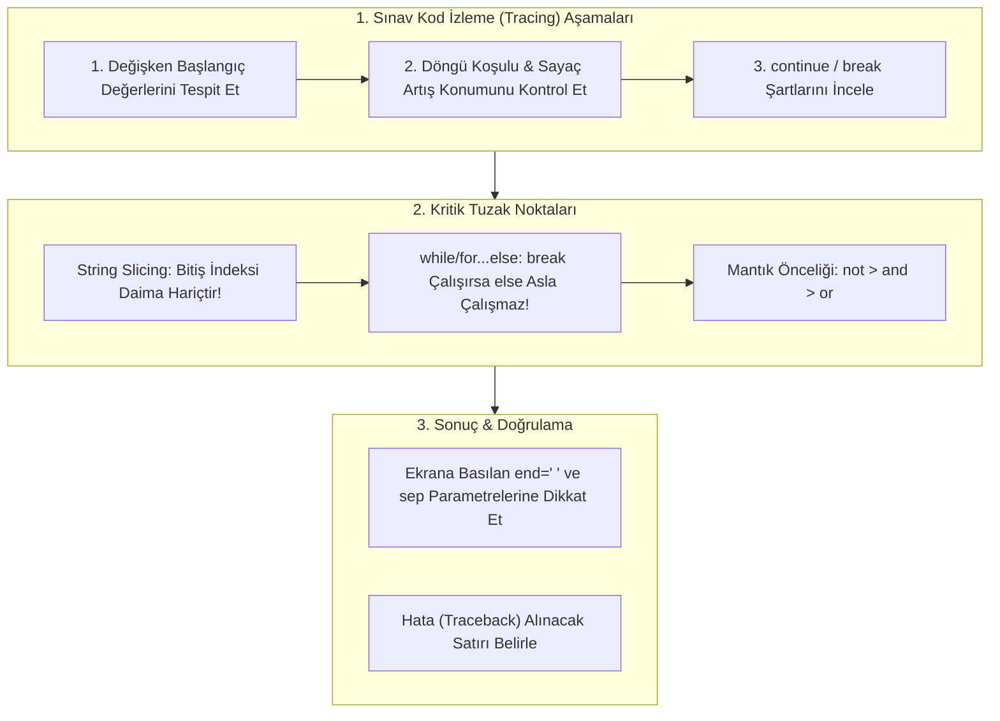

TARGET DECK: data

# 🐍 VBA207 Python Programlama: Vize Kod İzleme, Çıkmış Sorular ve Sınav Tuzakları Analizi

---

## 📋 Ders ve Not Bilgileri

| 🏷️ Alan | 📌 Bilgi / Değer |
| :--- | :--- |
| **Ders Kodu & Adı** | VBA207 - Python Programlama |
| **Bölüm & Dönem** | Sakarya Üniversitesi - Veri Bilimi ve Analitiği (2. Sınıf Güz) |
| **Öğretim Üyesi** | Dr. Özkan CANAY |
| **Konu Başlığı** | Vize Kod İzleme (Code Tracing), Çoktan Seçmeli Test Soru Analizi, Edge-Case Tuzakları |
| **Bağlantılı Notlar** | [[H01_Kurulum_ve_Temel_Sozdizimi]] · [[H02_Degiskenler_ve_Temel_Veri_Tipleri]] · [[H03_Operatorler_ve_Karar_Yapilari]] · [[H04_Donguler_While_For_ve_Karakter_Dizileri]] · [[H05_Fonksiyonlar_ve_Scope]] · [[H06_Moduller_Paketler_ve_Kutuphaneler]] |
| **Durum / Seviye** | 🟢 Tamamlandı (Vize Öncesi Mutlak Çözülmesi Gereken Soru Havuzu) |

---

## 🎯 Zihin Haritası: Kod İzleme Stratejisi



---

## 📝 ÇÖZÜMLÜ SORU VE TUZAK ANALİZLERİ

### 🔹 Soru 1: While Döngüsü ile Kümülatif Toplam İzleme
Aşağıdaki kod çalıştırıldığında ekrana yazdırılacak değer nedir?

```python
i = 1 
toplam = 0 

while i <= 4: 
    toplam += i 
    i += 1 

print("toplam :", toplam)
```

- **Seçenekler:** A) 4 &nbsp;&nbsp; B) 6 &nbsp;&nbsp; C) 10 &nbsp;&nbsp; D) 15
- **Doğru Yanıt:** **C) 10**
- **Adım Adım İzleme (Trace Table):**
  1. Tur: `i = 1` ➔ `toplam = 0 + 1 = 1` ➔ `i = 2`
  2. Tur: `i = 2` ➔ `toplam = 1 + 2 = 3` ➔ `i = 3`
  3. Tur: `i = 3` ➔ `toplam = 3 + 3 = 6` ➔ `i = 4`
  4. Tur: `i = 4` ➔ `toplam = 6 + 4 = 10` ➔ `i = 5`
  5. Tur: `i = 5` ➔ `5 <= 4` koşulu `False` olur, döngü sonlanır.
- **Hoca Tuzağı:** Sayacın başlangıç değeri `1` ve `<= 4` koşulu nedeniyle $1 + 2 + 3 + 4 = 10$ üretilir.

---

### 🔹 Soru 2: `continue` Atlama ve Sayaç Konumu
Aşağıdaki kod çalıştırıldığında ekrana yazılacak değerler hangi seçenekte doğru verilmiştir?

```python
i = 0
while i < 10:
    i += 1
    if i % 2 == 0:
        continue
    print(i, end=" ")
```

- **Seçenekler:**
  - A) 0 2 4 6 8 10
  - B) 1 3 5 7 9
  - C) 1 3 5 7 9 11
  - D) Sonsuz döngüye girer
- **Doğru Yanıt:** **B) 1 3 5 7 9**
- **Çözüm Mantığı:**
  `i += 1` ifadesi `continue` kontrolünden **önce** yazılmıştır. Bu nedenle `i` her turda başarıyla artar.
  `i` çift sayı olduğunda (`i % 2 == 0`), `continue` çalışır ve `print` atlanır.
  `i = 9` turunda tek olduğu için yazılır. Sonraki turda `i = 10` olur, çift olduğu için atlanır ve `10 < 10` koşulu `False` olup biter.

---

### 🔹 Soru 3: Karakter Dizisi Dilimleme ve Küçük Harfe Çevirme
Aşağıdaki Python kodunun çıktısı nedir?

```python
s = "Sakarya"
print(s[1:5].lower())
```

- **Seçenekler:** A) sakar &nbsp;&nbsp; B) akar &nbsp;&nbsp; C) akar &nbsp;&nbsp; D) kary
- **Doğru Yanıt:** **B) akar**
- **Çözüm Analizi:**
  - `s[0] = 'S'`
  - `s[1] = 'a'`
  - `s[2] = 'k'`
  - `s[3] = 'a'`
  - `s[4] = 'r'`
  - `s[5] = 'y'` (Bitiş indeksi 5 **hariçtir!**)
  - `s[1:5]` dilimi `"akar"` karakterlerini üretir. `.lower()` bunu küçük harf olarak korur.

---

### 🔹 Soru 4: Liste Üreteci ve İndeks Toplamı
Aşağıdaki kod çalıştırıldığında çıktı ne olur?

```python
kareler = [i ** 2 for i in range(1, 5)]
print(kareler[1] + kareler[2])
```

- **Seçenekler:** A) 5 &nbsp;&nbsp; B) 13 &nbsp;&nbsp; C) 25 &nbsp;&nbsp; D) 20
- **Doğru Yanıt:** **B) 13**
- **Çözüm Analizi:**
  `range(1, 5)` sayıları: `1, 2, 3, 4`.
  Kareleri: `kareler = [1, 4, 9, 16]`.
  - `kareler[0] = 1`
  - `kareler[1] = 4`
  - `kareler[2] = 9`
  - `kareler[3] = 16`
  Toplama: `4 + 9 = 13`.

---

### 🔹 Soru 5: `for...else` Doğal Bitiş Tuzağı
Aşağıdaki kod parçasının ekran çıktısı nedir?

```python
for i in range(3):
    print(i, end=" ")
else:
    print("| bitti")
```

- **Seçenekler:**
  - A) 1 2 3 | bitti
  - B) 0 1 2 3 | bitti
  - C) 0 1 2 | bitti
  - D) 0 1 2
- **Doğru Yanıt:** **C) 0 1 2 | bitti**
- **Çözüm Mantığı:**
  1. `range(3)` üretimi `0, 1, 2` olur (3 hariçtir ve 0'dan başlar).
  2. Döngü içinde `break` olmadığı için iterasyon başarıyla tamamlanır ve `else` bloğu çalışarak `| bitti` yazdırır.

---

### 🔹 Soru 6: Mantıksal Öncelik ve Değerlendirme
Aşağıdaki mantıksal ifadenin Python'daki boolean sonucu nedir?

```python
durum = not (5 > 3) or (10 == 10 and 3 != 3)
print(durum)
```

- **Seçenekler:** A) True &nbsp;&nbsp; B) False &nbsp;&nbsp; C) None &nbsp;&nbsp; D) TypeError
- **Doğru Yanıt:** **B) False**
- **Çözüm Analizi:**
  1. `5 > 3` ➔ `True`. `not (True)` ➔ **`False`**.
  2. `10 == 10` ➔ `True`. `3 != 3` ➔ `False`.
  3. `(True and False)` ➔ **`False`**.
  4. `False or False` ➔ **`False`**.

---

### 🔹 Soru 7: String Parçalama (`split`) ve Karakter Sayma (`count`)
Aşağıdaki kodun çıktısı nedir?

```python
metin = "veri-bilimi"
print(metin.split("-")[1].count("i"))
```

- **Seçenekler:** A) 1 &nbsp;&nbsp; B) 2 &nbsp;&nbsp; C) 3 &nbsp;&nbsp; D) 4
- **Doğru Yanıt:** **C) 3**
- **Çözüm Analizi:**
  - `metin.split("-")` ifadesi `['veri', 'bilimi']` listesini döner.
  - `[1]` indeksi listenin ikinci elemanı olan `'bilimi'` kelimesini alır.
  - `'bilimi'.count("i")` ise metindeki 3 adet 'i' harfini sayar (b**i**l**i**m**i**).

---

### 🔹 Soru 8: Üç Parametreli `pow()` Fonksiyonu
Aşağıdaki fonksiyon çağrısının üreteceği tamsayı sonuç nedir?

```python
print(pow(25, 2, 5))
```

- **Seçenekler:** A) 625 &nbsp;&nbsp; B) 125 &nbsp;&nbsp; C) 5 &nbsp;&nbsp; D) 0
- **Doğru Yanıt:** **D) 0**
- **Çözüm Mantığı:**
  Formül: `(taban ** us) % mod` ➔ `(25 ** 2) % 5 = 625 % 5 = 0`.

---

### 🔹 Soru 9: Sözlüklerde Üyelik (`in`) Arama Alanı
Aşağıdaki kod çalıştırıldığında çıktılar sırasıyla ne olur?

```python
rehber = {"Ahmet": "555-1234", "Mehmet": "555-5678"}
print("Ahmet" in rehber, "555-1234" in rehber)
```

- **Seçenekler:**
  - A) True True
  - B) False False
  - C) True False
  - D) False True
- **Doğru Yanıt:** **C) True False**
- **Kritik Sınav Kuralı:** Sözlüklerde `in` operatörü **sadece anahtarlar (keys)** üzerinde arama yapar; değerler (values) üzerinde arama yapmaz!

---

### 🔹 Soru 10: `*args` ve `**kwargs` Uzunluk Hesabı
Aşağıdaki kodun ekran çıktısı nedir?

```python
def analiz(*args, **kwargs):
    return len(args) + len(kwargs)

print(analiz(1, 2, x=10, y=20, z=30))
```

- **Seçenekler:** A) 3 &nbsp;&nbsp; B) 4 &nbsp;&nbsp; C) 5 &nbsp;&nbsp; D) 6
- **Doğru Yanıt:** **C) 5**
- **Çözüm Analizi:**
  - `args` pozisyonel argümanları alır: `(1, 2)` ➔ `len(args) = 2`.
  - `kwargs` isimli argümanları alır: `{'x': 10, 'y': 20, 'z': 30}` ➔ `len(kwargs) = 3`.
  - Toplam: `2 + 3 = 5`.

---

## 🧑‍💻 Senior Field Tips & Industry Reality

> [!EXAMPLE] 🧑‍💻 Senior Field Tips & Industry Reality
> - **Sınavda Zaman Yönetimi:** Soru kâğıdında uzun bir döngü gördüğünde hemen 50 turu elle yazmaya kalkma! Döngünün ilk 2 turunu (pattern) yaz, ardından koşulun nerede sonlandığına ve `break` olup olmadığına bak.
> - **Off-By-One Hatası:** Python'da `range(5)` ifadesinin 5'i içermediğini, son sayının 4 olduğunu ve `[1:5]` diliminin 5. indeksi almadığını beynine kazı.

---

## 🃏 Anki Kartları

START
Temel
TARGET DECK: data
Ön: `metin = "veri-bilimi"; print(metin.split("-")[1].count("i"))` kodunun çıktısı nedir ve işlem sırası nasıldır?
Geri: Çıktı: **`3`**<br><br>1. `.split("-")` ➔ `['veri', 'bilimi']`<br>2. `[1]` ➔ `'bilimi'`<br>3. `'bilimi'.count("i")` ➔ 3 adet 'i' harfi.
Tags: from_obsidian, vba207, python, kod_izleme
END

START
Temel
TARGET DECK: data
Ön: `rehber = {"Ali": 100}; print(100 in rehber)` kodunun çıktısı neden `False` olur?
Geri: Çünkü sözlüklerde `in` operatörü doğrudan **anahtarları (keys)** arar. `100` bir anahtar değil **değer (value)** olduğu için `False` döner. Değer aramak için `100 in rehber.values()` yazılmalıdır.
Tags: from_obsidian, vba207, python, sozlukler
END
